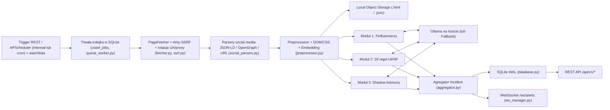

# Architektura i Implementacja Backendu `Ryziqo`

Kompletny opis techniczny backendu systemu `Ryziqo` (HackNation UKNF 2026) — zaprojektowanego jako lekki, niezależny serwis w **Pythonie + FastAPI**, w 100% **open-source i on-premise** (bez płatnych zewnętrznych API), zgodny z zamrożonym kontraktem [CONTRACT.md](../CONTRACT.md).

---

## 1. Przepływ danych (End-to-End)



---

## 2. Struktura modułów backendu

```text
backend/
├── Dockerfile                        # python:3.12-slim, non-root appuser, HEALTHCHECK
├── requirements.txt                  # Zależności runtime, przypięte wersje (MIT / BSD / Apache-2.0)
├── requirements-dev.txt              # + pytest, pip-audit (poza obrazem produkcyjnym)
├── requirements-playwright.txt       # Opcjonalny Playwright (build-arg INSTALL_PLAYWRIGHT=true)
├── pytest.ini
├── app/
│   ├── main.py                       # FastAPI app, lifespan, CORS, /api/v1/health
│   ├── config.py                     # Ustawienia ładowane wyłącznie z .env (pydantic-settings)
│   ├── models.py                     # Schematy Pydantic 1:1 z CONTRACT.md
│   ├── database.py                   # SQLite WAL, Object Storage, agregacje, kalibracja FP/FN
│   ├── knf_registry.py               # Loader snapshotu 5 rejestrów KNF + 18 reguł UKNF
│   ├── ws_manager.py                 # Odporny na rozłączenia manager połączeń /ws/alerts
│   ├── queue_worker.py               # Trwała kolejka (SQLite) + harmonogram APScheduler (interwał/cron) + watchlista
│   ├── scraper/
│   │   ├── ssrf.py                   # Walidacja anty-SSRF (schemat, DNS, prywatne/metadata IP)
│   │   ├── fetcher.py                # httpx (limity/redirecty/rotacja UA i proxy) + wybór fallbacku + mock loader
│   │   ├── browser.py                # Playwright/Chromium: render JS, metryki z computed styles, anty-SSRF przeglądarki
│   │   └── social_parsers.py         # Autor, treść posta, data, hashtagi, wzmianki, linki (FB/IG/TikTok/YT/X)
│   ├── ai/
│   │   ├── preprocessor.py           # Czyszczenie HTML, NFKC, anty-obfuskacja, ukryty tekst/injection, sekcje, DOM/CSS, wektor 128-dim
│   │   ├── ollama_client.py          # Klient natywnej Ollamy (JSON Schema w `format`, num_predict/num_ctx, embeddings, VLM)
│   │   ├── schemas.py                # Schemat odpowiedzi LLM, katalog sygnałów per moduł, weryfikacja cytatów
│   │   ├── prompting.py              # Piaskownica <untrusted_content>, rubryka, checklisty, few-shot (hard negatives)
│   │   ├── context.py                # Budowa kontekstu promptu (sekcje dokumentu, RAG, linki)
│   │   ├── fusion.py                 # Nieliniowa fuzja reguł i zweryfikowanych sygnałów LLM (FN boost, weto FP)
│   │   ├── retrieval.py              # RAG few-shot z incydentów zweryfikowanych + wykrywanie klonów kampanii
│   │   ├── vision_analyzer.py        # Opcjonalna analiza VLM zrzutów ekranu (banery, czytelność ryzyka, logotypy)
│   │   ├── solicitation.py           # Moduł 2: sygnały nakłaniania do wpłat / zdalnego dostępu (scam)
│   │   ├── monetary_offer.py         # Moduł 2: oferty pieniężne (kwoty, terminy, bonusy, presja czasu)
│   │   ├── module1_finfluencers.py   # Moduł 1: Finfluencerzy i promocja transgraniczna
│   │   ├── module2_risk_compliance.py# Moduł 2: 18 kryteriów MiFID II / rozp. 2017/565
│   │   ├── module3_shadow_advisory.py# Moduł 3: Shadow Advisory (art. 76, 2, 3 u.o.i.f.)
│   │   └── aggregator.py             # Moduły równolegle, guard KNF, klony, VLM, tryb primary/all_significant
│   └── routers/
│       ├── incidents.py              # /incidents, /incidents/{id}, PATCH /status, PATCH /label, /stats
│       ├── analyze.py                # POST /analyze/text, POST /analyze/url (analiza na żądanie)
│       ├── crawl.py                  # POST /crawl/trigger, /crawl/jobs, /knf-registry, /rules, /mock-sites
│       ├── watchlist.py              # /watchlist (CRUD) + POST /watchlist/run
│       ├── reports.py                # GET /reports/{module_id}?format=json|csv
│       └── ws.py                     # WebSocket /ws/alerts
├── scripts/
│   └── evaluate_detection.py         # Benchmark Precision/Recall/F1 na data/eval_golden_dataset.json (fallback / ollama / both)
└── tests/
    ├── test_ssrf.py                  # 14 przypadków blokady anty-SSRF
    ├── test_modules.py               # Testy Modułów 1–3, DOM/CSS i embeddingów
    ├── test_api.py                   # Testy integracyjne REST, analizy na żądanie, etykiet, kalibracji i WebSocket
    ├── test_crawler_features.py      # Parsery social, proxy, trwała kolejka, watchlista, near-dup, raporty, risk_level
    ├── test_ai_detection.py          # Obfuskacja, anti-injection, weryfikacja cytatów, fuzja, RAG, klony, KNF fuzzy, VLM (mock Ollama)
    ├── test_solicitation.py          # Sygnały nakłaniania do wpłat i oferty pieniężne (Moduł 2)
    └── test_browser.py               # Playwright: render SPA, computed styles, anty-SSRF przeglądarki (pomijane bez Chromium)
```

---

## 3. Warstwa API, cykl życia i WebSocket

- **Cykl życia (`backend/app/main.py`):** w `lifespan` backend uruchamia niedestrukcyjną inicjalizację schematu SQLite (`CREATE TABLE IF NOT EXISTS`), zasila bazę 14 syntetycznymi rekordami startowymi (`data/demo_incidents_seed.json`) wyłącznie jeśli tabela `incidents` jest pusta, wczytuje snapshot KNF i 18 reguł, sprawdza stan Ollamy oraz uruchamia workera kolejki i `APScheduler`.
- **REST API (`routers/incidents.py`, `routers/analyze.py`, `routers/crawl.py`):**
  - `GET /api/v1/health` — status serwisu, dostępność Ollama, tryb (`live` / `demo_fallback`), data i zastrzeżenie snapshotu KNF, liczba incydentów i status harmonogramu.
  - `GET /api/v1/incidents` — paginacja i filtrowanie po `module_id`, `source_platform`, `status`, `min_risk_score`, `max_risk_score`, `date_from`, `date_to`, `search`.
  - `GET /api/v1/incidents/{id}` — pełne szczegóły incydentu wraz z `raw_text_preview` pobranym z lokalnego Object Storage.
  - `PATCH /api/v1/incidents/{id}/status` — zmiana statusu (`new`, `in_review`, `confirmed`, `false_positive`, `dismissed`) i `analyst_note`, zapis w SQLite + natychmiastowy event `status_updated` na `/ws/alerts`.
  - `PATCH /api/v1/incidents/{id}/label` *(v1.1.0)* — etykieta referencyjna analityka `ground_truth_label` (`true` / `false` / `null`) do kalibracji; event `status_updated` z `extra.ground_truth_label`.
  - `GET /api/v1/stats?threshold=0.50` — KPI, podziały (moduł, źródło, status), szeregi czasowe `trend_by_day` (pod Recharts/Chart.js), top naruszane reguły oraz wyliczona macierz pomyłek `TP / FP / TN / FN` (`precision`, `recall`, `f1_score`) dla rekordów z `ground_truth_label`.
  - `POST /api/v1/crawl/trigger` (`202 Accepted`) — kolejkowanie zadań w trybach `mock_all`, `mock_single` oraz `public_url` (z natychmiastową walidacją anty-SSRF przed dodaniem do kolejki).
  - `POST /api/v1/analyze/text` *(v1.1.0)* — synchroniczna analiza wklejonej treści (20–20 000 znaków). Tekst jest escapowany i opakowywany w minimalny HTML (`build_manual_text_page`), `source_platform: "manual"`; nic nie jest pobierane z sieci.
  - `POST /api/v1/analyze/url` *(v1.1.0)* — synchroniczne pobranie jednego publicznego URL przez `PageFetcher` (anty-SSRF na każdym przekierowaniu, limity rozmiaru/przekierowań) i analiza; `400` dla adresów zablokowanych, `502` dla błędów pobierania.
  - Kolejka i analiza na żądanie współdzielą `CrawlQueueWorker.analyze_page()` — ten sam preprocessing, zapis do Object Storage, Moduły 1–3, deduplikację po `content_hash` (zachowuje status i etykietę analityka) oraz alerty `high_risk_alert`.
  - `GET /api/v1/crawl/jobs`, `GET /api/v1/knf-registry`, `GET /api/v1/rules`, `GET /mock-sites/{filename}`.
  - *(v1.2.0)* `GET /api/v1/incidents?risk_level=high`, watchlista `GET/POST /api/v1/watchlist`, `PATCH/DELETE /api/v1/watchlist/{id}`, `POST /api/v1/watchlist/run`, raporty `GET /api/v1/reports/{module_id}?format=json|csv` (CSV z ochroną przed formula injection).
- **WebSocket (`ws_manager.py`, `routers/ws.py`):** kanał `/ws/alerts` obsługuje `ping`/`pong` i emituje ustrukturyzowane komunikaty `connected`, `crawler_status` (`queued`, `fetching`, `preprocessing`, `analyzing`), `high_risk_alert` (gdy `risk_score >= HIGH_RISK_ALERT_THRESHOLD`, domyślnie `0.65`), `analysis_complete`, `status_updated` oraz `error`. Rozłączenie klienta usuwa gniazdo z puli bez przerywania bieżącego crawla.

---

## 4. Silnik scrapujący, kolejka i ochrona anty-SSRF

- **Walidacja anty-SSRF (`scraper/ssrf.py`):**
  - Dopuszcza wyłącznie schematy `http` i `https` bez poświadczeń w URL.
  - Blokuje nazwy hostów lokalnych i wewnętrznych (`localhost`, `*.local`, `*.internal`, `metadata.google.internal`, `host.docker.internal`).
  - Rozwiązuje DNS (`socket.getaddrinfo`) i odrzuca adresy prywatne (`10/8`, `172.16/12`, `192.168/16`, `fc00::/7`), loopback (`127/8`, `::1`), IPv4-mapped IPv6 (`::ffff:127.0.0.1`), link-local / cloud metadata (`169.254.0.0/16`, `fe80::/10`), multicast oraz zarezerwowane.
  - W `fetcher.py` przekierowania są obsługiwane ręcznie (`follow_redirects=False`, max 5 hopów), a walidacja anty-SSRF jest wykonywana ponownie na każdym przekierowaniu.
- **Pobieranie (`scraper/fetcher.py`):** asynchroniczny `httpx` z timeoutem (`12s`), limitem strumienia (`2 MB`), walidacją `Content-Type`, łagodnym rate-limitingiem (`0.5s`), transparentną rotacją User-Agent oraz rotacją proxy z `CRAWLER_PROXIES` (bez omijania kontroli dostępu). - **Renderowanie JS (`scraper/browser.py`, obraz z `INSTALL_PLAYWRIGHT=true`):** uruchamiane gdy `use_playwright: true` albo przy `CRAWLER_USE_PLAYWRIGHT_FALLBACK=true`, jeśli strona po usunięciu skryptów ma mniej niż `CRAWLER_PLAYWRIGHT_MIN_TEXT_CHARS` znaków widocznego tekstu (powłoka SPA). Headless Chromium z tym samym proxy co httpx, timeout `CRAWLER_PLAYWRIGHT_TIMEOUT_SECONDS`, maks. 2 równoległe rendery, `--disable-dev-shm-usage` (Docker), zablokowane service workery, pobieranie plików oraz obrazy/media/fonty.
  - **Anty-SSRF w przeglądarce:** każde żądanie (nawigacja, skrypty, `fetch`/XHR) i każdy WebSocket przechodzi przez `validate_public_url` (DNS w wątku, cache per host). Chromium podąża za przekierowaniami bez ponownego wywołania `route`, dlatego handler sam pobiera odpowiedź (`route.fetch(max_redirects=0)`), waliduje każdy krok łańcucha `Location` (limit `CRAWLER_MAX_REDIRECTS`) i oddaje przeglądarce dopiero końcową odpowiedź. Wyrenderowany DOM jest ograniczony do `CRAWLER_MAX_BYTES`.
  - **Metryki z computed styles:** w kontekście strony liczone są rozmiar czcionki ostrzeżenia vs. mediana ważona długością tekstu (Reguła 4), kontrast WCAG z rzeczywistym tłem i efektywną przezroczystością (< 4.5:1, Reguła 5), umieszczenie w stopce/sekcji prawnej (Reguła 6), treść w zamkniętym `<details>` (Reguła 7) i overflow przy `375x667` (Reguła 8). Uwzględniają zewnętrzne arkusze CSS i style nadane przez JS, więc mają pierwszeństwo przed statyczną analizą inline CSS.
  - **Znane ograniczenie:** walidacja DNS i połączenie wykonywane przez Playwright to dwa osobne rozwiązania nazwy (teoretyczne okno na DNS rebinding). Przy wdrożeniu produkcyjnym ruch wychodzący crawlera powinien iść przez proxy egress z blokadą sieci prywatnych.
- **Parsery social media (`scraper/social_parsers.py`):** dla `facebook`, `instagram`, `tiktok`, `youtube`, `x` odczytują schema.org JSON-LD (`SocialMediaPosting`, `VideoObject`), OpenGraph / Twitter Card, uchwyt z ścieżki URL (`tiktok.com/@user`, `instagram.com/user`) i widoczne oznaczenie autora. Wynik (autor, treść posta, data publikacji, hashtagi, wzmianki, linki wychodzące) trafia do artefaktu JSON w Object Storage, a autor — do `promoter_name` w Module 1.
- **Zrzuty ekranu i linki (`fetcher.py`, `browser.py`):** przy `OLLAMA_VISION_ENABLED=true` render Playwright zapisuje zrzuty desktop (`1280x800`) i mobile (`375x667`) w Object Storage (`Database.save_screenshots`) dla analizy VLM. Przy `CRAWLER_EXPAND_SHORT_LINKS=true` skracacze i link-in-bio (`bit.ly`, `linktr.ee` itp.) są rozwijane z walidacją anty-SSRF na każdym kroku — ustalane są wyłącznie domeny docelowe (sprawdzane w rejestrze/liście ostrzeżeń KNF), bez pobierania pełnej treści landing page'a.
- **Lokalne źródła demonstracyjne (`data/mock_sites/*.html`):** ładowane osobną, odizolowaną ścieżką z ochroną przed path traversal, jawnie oznaczone jako syntetyczne (`mock://...`, `[MOCK DEMO]`).
- **Kolejka i harmonogram (`queue_worker.py`):** trwała kolejka w tabeli `crawl_jobs` (parametry zadania w `request_json`, atomowe pobieranie `BEGIN IMMEDIATE`, zadania przerwane restartem wracają do kolejki) + `APScheduler` (`AsyncIOScheduler`) z wyzwalaczem interwałowym lub crontab (`CRAWLER_CRON`), `max_instances=1`, `coalesce=True`. Każdy cykl skanuje mock-strony demo (opcjonalnie) oraz wszystkie aktywne cele z tabeli `watch_targets` — to mechanizm okresowej aktualizacji raportu Modułu 1. Cele w trakcie przetwarzania są pomijane.

---

## 5. Preprocessing, 3 moduły analityczne i lokalne AI (Ollama)

### Preprocessing (`ai/preprocessor.py`)
- Usuwa elementy nietekstowe (`<script>`, `<style>`, `<noscript>`, `<svg>`), normalizuje tekst (Unicode NFKC + białe znaki), dzieli na zdania i liczy skrót `SHA-256` (`content_hash`) do deduplikacji.
- **Anty-obfuskacja:** homoglify (cyrylica → łacina), znaki zero-width, rozstrzelone słowa (`z.y.s.k`, `g w a r a n t o w a n y`).
- **Ukryty tekst i prompt injection:** węzły z `display:none`, `visibility:hidden`, `font-size:0`, `opacity:0` są raportowane osobno (nie trafiają do promptu jako treść). Sam ukryty tekst nie jest naruszeniem — sygnałem jest injection w ukrytym tekście (reguła `AI_PROMPT_INJECTION`, także w trybie fallback) lub niewidoczne ostrzeżenie o ryzyku.
- **Sekcje dokumentu:** nagłówki/hero, fragment treści, klauzule ryzyka i stopka, linki/CTA/hashtagi — mieszczą się w budżecie `AI_PROMPT_CONTENT_CHARS` zamiast ślepego ucinania tekstu.
- Ekstrahuje **metryki DOM/CSS** z inline stylów i bloków `<style>` (plus metryki z computed styles przeglądarki, gdy strona była renderowana przez Playwright — mają pierwszeństwo): `dominant_font_px`, `risk_font_px`, `font_ratio`, `risk_hidden_in_footer`, `requires_click_to_view_risk` (`<details>`), `low_contrast_detected` (luminancja koloru hex/opacity), `responsive_overflow_detected`.
- Tworzy deterministyczną reprezentację wektorową 128-dim (feature hashing z normalizacją L2 + funkcja `cosine_similarity`), którą przy dostępnej Ollamie nadpisuje lokalnym embeddingiem z `/api/embeddings`.

### Trzy wyspecjalizowane moduły
1. **Moduł 1 — Finfluencerzy i podmioty trzecie (`ai/module1_finfluencers.py`):**
   - Dopasowuje nazwy/aliasy podmiotów z lokalnego snapshotu 5 rejestrów KNF (`data/knf_registry_snapshot.json`), rozpoznając także zagraniczne firmy inwestycyjne działające transgranicznie (`registered_eu_crossborder`).
   - Wykrywa sygnały afiliacji (`link w bio`, `link partnerski`, `kod polecający`, `bonus powitalny`), brak oznaczenia reklamy (`#reklama`, `#współpraca`) oraz obietnice zysków/dźwigni bez ostrzeżenia o ryzyku; odfiltrowuje materiały czysto edukacyjne.
2. **Moduł 2 — Zgodność i informacja o ryzyku (`ai/module2_risk_compliance.py`):**
   - Ocenia materiał bezpośrednio względem **18 reguł UKNF** z `data/risk_criteria_rules.json` (każde naruszenie zwraca dokładny `rule_id`, `rule_name`, `legal_basis` z MiFID II / rozp. del. 2017/565 oraz uzasadnienie).
   - Łączy deterministyczną analizę DOM/CSS (Reguły 4, 5, 6, 7, 8) z analizą treści (Reguły 1–3, 10 — spójność językowa, 11 — porównania, 12a/12b/14 — 5-letni okres wyników historycznych, waluta/prowizje, disclaimer, 15 — prognozy, 16 — informacja podatkowa, 17–18 — zakaz sugerowania aprobaty/bezpieczeństwa KNF).
3. **Moduł 3 — Shadow Advisory (`ai/module3_shadow_advisory.py`):**
   - Weryfikuje brak wpisu w lokalnym snapshocie KNF (`not_in_knf_snapshot`).
   - Wykrywa profil doradczy (`wealth management`, `family office`, `investment consulting`, `mentoring finansowy`) połączony z przesłankami indywidualnej rekomendacji z **art. 76 u.o.i.f.** oraz katalogiem instrumentów finansowych z **art. 2 i 3 u.o.i.f.** (akcje, obligacje, ETF, certyfikaty, opcje, kontrakty terminowe, CFD), jednocześnie nie flagując biur podatkowych (PIT-38) ani treści z jednoznacznym wyłączeniem doradztwa.

### Integracja z Ollama, fuzja i Fallback (`ai/ollama_client.py`, `ai/fusion.py`, `ai/aggregator.py`)

Pełny opis zmian detekcji v2 (diagnoza, fazy, świadome odstępstwa): [ai-detection-improvement-plan.md](./ai-detection-improvement-plan.md). Instalacja i wybór modelu: [ollama-llm-setup.md](./ollama-llm-setup.md).

- Backend łączy się z Ollamą działającą natywnie na hoście (`OLLAMA_BASE_URL`, w Dockerze `http://host.docker.internal:11434`) lub w kontenerze (profil `ai`), automatycznie wykrywając zainstalowany model open-source (preferując `gemma4`/`gemma3`/`qwen2.5`/`llama3`).
- **Structured output:** schemat JSON odpowiedzi (`ai/schemas.py`: `context_type`, `reasoning`, `signals[]` z `exact_quote`, `llm_risk_score`) jest przekazywany w polu `format` API Ollama (fallback na `format: "json"` dla starszych wersji); `OLLAMA_NUM_PREDICT` / `OLLAMA_NUM_CTX` sterują budżetem.
- **Bezpieczeństwo promptu (`ai/prompting.py`):** treść strony w piaskownicy `<untrusted_content>` z jawnym zakazem wykonywania zawartych poleceń, rubryka ocen, checklisty sygnałów per moduł i few-shot z *hard negatives*.
- **Anti-Hallucination Guard:** sygnał LLM liczy się tylko, gdy jego `exact_quote` występuje w tekście źródłowym (`AI_STRICT_QUOTE_VERIFICATION`).
- **Nieliniowa fuzja (`ai/fusion.py`):** `risk_score = max(wynik_reguł, mieszanka_liniowa, ai_verified)`, gdzie `ai_verified` jest ograniczony własną oceną modelu i siłą zweryfikowanych dowodów; zweryfikowane sygnały dodają reguły `AI_*`. **Weto FP** obniża wynik treści `educational` / `journalism_warning` (limit `0.35`), ale nie działa przy twardym CTA komercyjnym, zweryfikowanym sygnale `explicit` ani wykrytym prompt injection.
- **RAG i klony (`ai/retrieval.py`):** do promptu dołączane są najbardziej podobne incydenty zweryfikowane przez analityków (`ground_truth_label` / `status`, z `analyst_note`); podobieństwo `>= AI_CLONE_SIMILARITY_THRESHOLD` do potwierdzonego incydentu z innej domeny dodaje regułę `CAMPAIGN_CLONE_MATCH` i podbija wynik.
- **KNF (`knf_registry.py`):** fuzzy matching (Levenshtein na tokenach złożonych/domenach) wykrywa podszywanie się pod licencjonowane podmioty (`KNF_IMPERSONATION_SUSPECT`); trafienie w lokalnym snapshocie Listy Ostrzeżeń (`data/knf_warnings_snapshot.json`, **wyłącznie fikcyjne wpisy demo**) podbija ryzyko do `>= 0.90` (`KNF_WARNING_LIST_MATCH`).
- **VLM (`ai/vision_analyzer.py`, `OLLAMA_VISION_ENABLED`):** model z obsługą obrazów ocenia zrzuty ekranu — obietnice zysku w grafikach, czytelność ostrzeżenia (kryteria 4–6, 8), wizerunki instytucji i osób publicznych (`AI_VLM_*`).
- Gdy Ollama jest niedostępna, system automatycznie i bezawaryjnie przechodzi na tryb `demo_fallback` (silnik deterministyczny 18 reguł + DOM/CSS + anti-injection + KNF fuzzy/ostrzeżenia + seedowane rekordy w SQLite), jawnie oznaczając to w `mode`, `model_used` oraz `is_demo_fallback`.
- `aggregator.py` uruchamia Moduły 1–3 równolegle i łączy wyniki w obiekty `Incident`: `AGGREGATOR_MULTI_MODULE_MODE=primary` (domyślnie, jeden incydent na stronę, wykrycia wtórne z prefiksem `[Wtórne]`) lub `all_significant` (incydent per moduł z naruszeniami). Deduplikacja w `queue_worker.py`: najpierw dokładnie po `(module_id, content_hash)`, potem semantycznie — ponowny skan tego samego URL z podobieństwem kosinusowym embeddingów `>= DEDUP_SIMILARITY_THRESHOLD` aktualizuje istniejący incydent (zmienione liczniki czy komentarze nie tworzą duplikatów).

---

## 6. Warstwa składowania i konteneryzacja

- **SQLite (`database.py`):** tryb `WAL`, klucze obce włączone, 4 tabele (`incidents`, `content_snapshots` z pełnym embeddingiem, `crawl_jobs`, `watch_targets`), addytywne migracje kolumn przy starcie + indeksy po `module_id`, `risk_score`, `status`, `detected_at` i `(module_id, content_hash)`. Wszystkie zapytania używają wyłącznie parametrów bindowanych (`?`).
- **Local Object Storage:** surowe pobrane strony (`<hash>.html`), przetworzone artefakty JSON (`<hash>.json` z tekstem i wektorem) oraz opcjonalne zrzuty ekranu dla VLM zapisywane w `OBJECT_STORE_DIR` i wiązane z rekordem poprzez `storage_key`. Wektory incydentów zweryfikowanych przez analityków (`list_verified_incident_vectors`) zasilają RAG i wykrywanie klonów.
- **Docker (`backend/Dockerfile`, `docker-compose.yml`):**
  - Lekki obraz `python:3.12-slim` z nieuprzywilejowanym użytkownikiem `appuser` i wbudowanym `HEALTHCHECK`.
  - Trwały wolumen `investwatch_data:/data` gwarantujący zachowanie bazy SQLite i Object Storage między restartami.
  - Wpis `extra_hosts: ["host.docker.internal:host-gateway"]` zapewniający łączność z natywną Ollamą również pod Linuksem.
  - Profil `ai` (`docker compose --profile ai up`): serwis `ollama` (przypięty obraz `ollama/ollama:${OLLAMA_IMAGE_TAG}`, wolumen `ollama_models`) i jednorazowy `ollama-pull` pobierający `OLLAMA_MODEL` i `OLLAMA_EMBED_MODEL` — cały stos z lokalnym LLM jedną komendą.
  - Serwis `frontend` (Nginx) wystawia panel na porcie `3000` i przekazuje `/api/` oraz `/ws/` do `backend:8000` w sieci Compose; startuje po uzyskaniu przez backend statusu `healthy`. Szczegóły: [frontend-architecture.md](./frontend-architecture.md).

---

## 7. Stan weryfikacji

- **Testy automatyczne (`pytest`):** **222 passed** (`2026-11-22`, API v1.4.0, z zainstalowanym Playwright/Chromium; bez Playwrighta testy `test_browser.py` są pomijane). Pokrycie: 14 wektorów anty-SSRF (`test_ssrf.py`), 3 moduły analityczne + DOM/CSS + przypadki negatywne (`test_modules.py`, `test_solicitation.py`), detekcja v2 z mockiem `OllamaClient` — obfuskacja, anti-injection, weryfikacja cytatów, fuzja (weto FP, FN boost), RAG, klony, KNF fuzzy, VLM (`test_ai_detection.py`), render i anty-SSRF przeglądarki (`test_browser.py`) oraz pełna integracja REST, analizy na żądanie, etykiet, kalibracji FP/FN i WebSocket (`test_api.py`, `test_crawler_features.py`).
- **Benchmark detekcji (`python -m scripts.evaluate_detection --mode both`, próg `0.65`, 53 przypadki z `data/eval_golden_dataset.json`, 2026-11-22):** reguły (`demo_fallback`) Precision **0.960**, Recall **0.686**, F1 **0.800** (1 FP, 11 FN — w tym 6 parafraz adversarial wymagających LLM); Ollama `gemma3:4b` Precision **0.931**, Recall **0.771**, F1 **0.844** (2 FP, 8 FN, śr. 36 s na przypadek). Pełny raport: `data/eval_report_gemma3-4b.json`. Instrukcja uruchomienia Ollamy: [ollama-llm-setup.md](./ollama-llm-setup.md).
- **Audyt bezpieczeństwa (`pip-audit -r requirements-dev.txt`, przypięte wersje):** `No known vulnerabilities found` (**0 znanych podatności**).
- Szczegóły licencji i zabezpieczeń: [security-licenses.md](./security-licenses.md).
- Proces pracy z asystentami AI: [ai-workflow.md](./ai-workflow.md).
- Checklista niezależnego audytu: [backend-audit-checklist.md](./backend-audit-checklist.md).
- Architektura panelu analitycznego: [frontend-architecture.md](./frontend-architecture.md).
