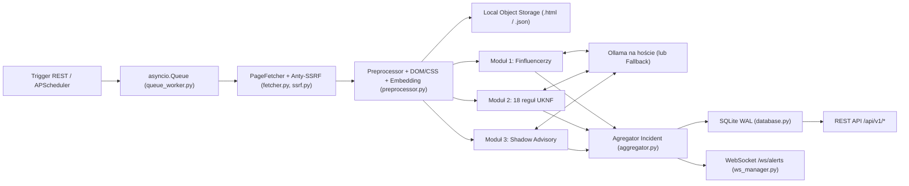

# Architektura i Implementacja Backendu `#InvestWatch`

Kompletny opis techniczny backendu systemu `#InvestWatch` (HackNation UKNF 2026) — zaprojektowanego jako lekki, niezależny serwis w **Pythonie + FastAPI**, w 100% **open-source i on-premise** (bez płatnych zewnętrznych API), zgodny z zamrożonym kontraktem [CONTRACT.md](../CONTRACT.md).

---

## 1. Przepływ danych (End-to-End)



---

## 2. Struktura modułów backendu

```text
backend/
├── Dockerfile                        # python:3.12-slim, non-root appuser, HEALTHCHECK
├── requirements.txt                  # Otwarte zależności (MIT / BSD / Apache-2.0)
├── pytest.ini
├── app/
│   ├── main.py                       # FastAPI app, lifespan, CORS, /api/v1/health
│   ├── config.py                     # Ustawienia ładowane wyłącznie z .env (pydantic-settings)
│   ├── models.py                     # Schematy Pydantic 1:1 z CONTRACT.md
│   ├── database.py                   # SQLite WAL, Object Storage, agregacje, kalibracja FP/FN
│   ├── knf_registry.py               # Loader snapshotu 5 rejestrów KNF + 18 reguł UKNF
│   ├── ws_manager.py                 # Odporny na rozłączenia manager połączeń /ws/alerts
│   ├── queue_worker.py               # Kolejka asyncio.Queue + harmonogram APScheduler
│   ├── scraper/
│   │   ├── ssrf.py                   # Walidacja anty-SSRF (schemat, DNS, prywatne/metadata IP)
│   │   └── fetcher.py                # httpx (limity/redirecty/UA) + Playwright fallback + mock loader
│   ├── ai/
│   │   ├── preprocessor.py           # Czyszczenie HTML, NFKC, SHA-256, DOM/CSS, wektor 128-dim
│   │   ├── ollama_client.py          # Klient natywnej Ollamy na hoście (JSON + embeddings)
│   │   ├── module1_finfluencers.py   # Moduł 1: Finfluencerzy i promocja transgraniczna
│   │   ├── module2_risk_compliance.py# Moduł 2: 18 kryteriów MiFID II / rozp. 2017/565
│   │   ├── module3_shadow_advisory.py# Moduł 3: Shadow Advisory (art. 76, 2, 3 u.o.i.f.)
│   │   └── aggregator.py             # Agregacja wyników 1–3 do obiektów Incident
│   └── routers/
│       ├── incidents.py              # /incidents, /incidents/{id}, PATCH /status, /stats
│       ├── crawl.py                  # POST /crawl/trigger, /crawl/jobs, /knf-registry, /rules, /mock-sites
│       └── ws.py                     # WebSocket /ws/alerts
└── tests/
    ├── test_ssrf.py                  # 14 przypadków blokady anty-SSRF
    ├── test_modules.py               # Testy Modułów 1–3, DOM/CSS i embeddingów
    └── test_api.py                   # Testy integracyjne REST, kalibracji i WebSocket
```

---

## 3. Warstwa API, cykl życia i WebSocket

- **Cykl życia (`backend/app/main.py`):** w `lifespan` backend uruchamia niedestrukcyjną inicjalizację schematu SQLite (`CREATE TABLE IF NOT EXISTS`), zasila bazę 14 syntetycznymi rekordami startowymi (`data/demo_incidents_seed.json`) wyłącznie jeśli tabela `incidents` jest pusta, wczytuje snapshot KNF i 18 reguł, sprawdza stan Ollamy oraz uruchamia workera kolejki i `APScheduler`.
- **REST API (`routers/incidents.py`, `routers/crawl.py`):**
  - `GET /api/v1/health` — status serwisu, dostępność Ollama, tryb (`live` / `demo_fallback`), data i zastrzeżenie snapshotu KNF, liczba incydentów i status harmonogramu.
  - `GET /api/v1/incidents` — paginacja i filtrowanie po `module_id`, `source_platform`, `status`, `min_risk_score`, `max_risk_score`, `date_from`, `date_to`, `search`.
  - `GET /api/v1/incidents/{id}` — pełne szczegóły incydentu wraz z `raw_text_preview` pobranym z lokalnego Object Storage.
  - `PATCH /api/v1/incidents/{id}/status` — zmiana statusu (`new`, `in_review`, `confirmed`, `false_positive`, `dismissed`) i `analyst_note`, zapis w SQLite + natychmiastowy event `status_updated` na `/ws/alerts`.
  - `GET /api/v1/stats?threshold=0.50` — KPI, podziały (moduł, źródło, status), szeregi czasowe `trend_by_day` (pod Recharts/Chart.js), top naruszane reguły oraz wyliczona macierz pomyłek `TP / FP / TN / FN` (`precision`, `recall`, `f1_score`) dla rekordów z `ground_truth_label`.
  - `POST /api/v1/crawl/trigger` (`202 Accepted`) — kolejkowanie zadań w trybach `mock_all`, `mock_single` oraz `public_url` (z natychmiastową walidacją anty-SSRF przed dodaniem do kolejki).
  - `GET /api/v1/crawl/jobs`, `GET /api/v1/knf-registry`, `GET /api/v1/rules`, `GET /mock-sites/{filename}`.
- **WebSocket (`ws_manager.py`, `routers/ws.py`):** kanał `/ws/alerts` obsługuje `ping`/`pong` i emituje ustrukturyzowane komunikaty `connected`, `crawler_status` (`queued`, `fetching`, `preprocessing`, `analyzing`), `high_risk_alert` (gdy `risk_score >= HIGH_RISK_ALERT_THRESHOLD`, domyślnie `0.65`), `analysis_complete`, `status_updated` oraz `error`. Rozłączenie klienta usuwa gniazdo z puli bez przerywania bieżącego crawla.

---

## 4. Silnik scrapujący, kolejka i ochrona anty-SSRF

- **Walidacja anty-SSRF (`scraper/ssrf.py`):**
  - Dopuszcza wyłącznie schematy `http` i `https` bez poświadczeń w URL.
  - Blokuje nazwy hostów lokalnych i wewnętrznych (`localhost`, `*.local`, `*.internal`, `metadata.google.internal`, `host.docker.internal`).
  - Rozwiązuje DNS (`socket.getaddrinfo`) i odrzuca adresy prywatne (`10/8`, `172.16/12`, `192.168/16`, `fc00::/7`), loopback (`127/8`, `::1`), IPv4-mapped IPv6 (`::ffff:127.0.0.1`), link-local / cloud metadata (`169.254.0.0/16`, `fe80::/10`), multicast oraz zarezerwowane.
  - W `fetcher.py` przekierowania są obsługiwane ręcznie (`follow_redirects=False`, max 5 hopów), a walidacja anty-SSRF jest wykonywana ponownie na każdym przekierowaniu.
- **Pobieranie (`scraper/fetcher.py`):** asynchroniczny `httpx` z timeoutem (`12s`), limitem strumienia (`2 MB`), walidacją `Content-Type`, łagodnym rate-limitingiem (`0.5s`) i transparentną rotacją User-Agent (bez omijania kontroli dostępu). Zawiera opcjonalny fallback `Playwright` do renderowania stron JS oraz pomiaru overflow na ekranie mobilnym (`375x667`).
- **Lokalne źródła demonstracyjne (`data/mock_sites/*.html`):** ładowane osobną, odizolowaną ścieżką z ochroną przed path traversal, jawnie oznaczone jako syntetyczne (`mock://...`, `[MOCK DEMO]`).
- **Kolejka i harmonogram (`queue_worker.py`):** asynchroniczny worker na `asyncio.Queue` zapisujący postęp w tabeli `crawl_jobs` + `APScheduler` (`AsyncIOScheduler`) uruchamiający cykliczny skan z zabezpieczeniem `max_instances=1` oraz zbiorem aktywnych celów (brak dublowania).

---

## 5. Preprocessing, 3 moduły analityczne i lokalne AI (Ollama)

### Preprocessing (`ai/preprocessor.py`)
- Usuwa elementy nietekstowe (`<script>`, `<style>`, `<noscript>`, `<svg>`), normalizuje tekst (Unicode NFKC + białe znaki), dzieli na zdania i liczy skrót `SHA-256` (`content_hash`) do deduplikacji.
- Ekstrahuje **metryki DOM/CSS** z inline stylów i bloków `<style>` (plus opcjonalne metryki z Playwright): `dominant_font_px`, `risk_font_px`, `font_ratio`, `risk_hidden_in_footer`, `requires_click_to_view_risk` (`<details>`), `low_contrast_detected` (luminancja koloru hex/opacity), `responsive_overflow_detected`.
- Tworzy deterministyczną reprezentację wektorową 128-dim (feature hashing z normalizacją L2 + funkcja `cosine_similarity`), którą przy dostępnej Ollamie nadpisuje lokalnym embeddingiem z `/api/embeddings`.

### Trzy wyspecjalizowane moduły
1. **Moduł 1 — Finfluencerzy i podmioty trzecie (`ai/module1_finfluencers.py`):**
   - Dopasowuje nazwy/aliasy podmiotów z lokalnego snapshotu 5 rejestrów KNF (`data/knf_registry_snapshot.json`), rozpoznając także zagraniczne firmy inwestycyjne działające transgranicznie (`registered_eu_crossborder`).
   - Wykrywa sygnały afiliacji (`link w bio`, `link partnerski`, `kod polecający`, `bonus powitalny`), brak oznaczenia reklamy (`#reklama`, `#współpraca`) oraz obietnice zysków/dźwigni bez ostrzeżenia o ryzyku; odfiltrowuje materiały czysto edukacyjne.
2. **Moduł 2 — Zgodność i informacja o ryzyku (`ai/module2_risk_compliance.py`):**
   - Ocenia materiał bezpośrednio względem **18 reguł UKNF** z `data/risk_criteria_rules.json` (każde naruszenie zwraca dokładny `rule_id`, `rule_name`, `legal_basis` z MiFID II / rozp. del. 2017/565 oraz uzasadnienie).
   - Łączy deterministyczną analizę DOM/CSS (Reguły 4, 5, 6, 7, 8) z analizą treści (Reguły 1–3, 10 — spójność językowa, 11 — porównania, 12a/12b/14 — 5-letni okres wyników historycznych, waluta/prowizje, disclaimer, 15 — prognozy, 16 — informacja podatkowa, 17–18 — zakaz sugerowania aprobaty/bezpieczeństwa KNF).
3. **Moduł 3 — Shadow Advisory (`ai/module3_shadow_advisory.py`):**
   - Weryfikuje brak wpisu w lokalnym snapshocie KNF (`not_in_knf_snapshot`).
   - Wykrywa profil doradczy (`wealth management`, `family office`, `investment consulting`, `mentoring finansowy`) połączony z przesłankami indywidualnej rekomendacji z **art. 76 u.o.i.f.** oraz katalogiem instrumentów finansowych z **art. 2 i 3 u.o.i.f.** (akcje, obligacje, ETF, certyfikaty, opcje, kontrakty terminowe, CFD), jednocześnie nie flagując biur podatkowych (PIT-38) ani treści z jednoznacznym wyłączeniem doradztwa.

### Integracja z Ollama i Fallback (`ai/ollama_client.py`, `ai/aggregator.py`)
- Backend łączy się z Ollamą działającą natywnie na hoście (`OLLAMA_BASE_URL`, w Dockerze `http://host.docker.internal:11434`), automatycznie wykrywając zainstalowany model open-source (preferując `gemma4`/`gemma3`/`qwen2.5`/`llama3`) i wymuszając odpowiedź w `format: "json"`.
- Gdy Ollama odpowiada, finalny `risk_score` (`0.00–1.00`) jest średnią ważoną wyniku reguł (65–70%) i oceny LLM (30–35%).
- Gdy Ollama jest niedostępna, system automatycznie i bezawaryjnie przechodzi na tryb `demo_fallback` (silnik deterministyczny 18 reguł + DOM/CSS + seedowane rekordy w SQLite), jawnie oznaczając to w `mode`, `model_used` oraz `is_demo_fallback`.
- `aggregator.py` łączy wyniki Modułów 1–3 w ujednolicony obiekt `Incident` i deduplikuje wpisy w SQLite po parze `(module_id, content_hash)`.

---

## 6. Warstwa składowania i konteneryzacja

- **SQLite (`database.py`):** tryb `WAL`, klucze obce włączone, 3 tabele (`incidents`, `content_snapshots`, `crawl_jobs`) + indeksy po `module_id`, `risk_score`, `status`, `detected_at` i `(module_id, content_hash)`. Wszystkie zapytania używają wyłącznie parametrów bindowanych (`?`).
- **Local Object Storage:** surowe pobrane strony (`<hash>.html`) oraz przetworzone artefakty JSON (`<hash>.json` z tekstem i wektorem) zapisywane w `OBJECT_STORE_DIR` i wiązane z rekordem poprzez `storage_key`.
- **Docker (`backend/Dockerfile`, `docker-compose.yml`):**
  - Lekki obraz `python:3.12-slim` z nieuprzywilejowanym użytkownikiem `appuser` i wbudowanym `HEALTHCHECK`.
  - Trwały wolumen `investwatch_data:/data` gwarantujący zachowanie bazy SQLite i Object Storage między restartami.
  - Wpis `extra_hosts: ["host.docker.internal:host-gateway"]` zapewniający łączność z natywną Ollamą również pod Linuksem.
  - Serwis `frontend` (Nginx) wystawia panel na porcie `3000` i przekazuje `/api/` oraz `/ws/` do `backend:8000` w sieci Compose; startuje po uzyskaniu przez backend statusu `healthy`. Szczegóły: [frontend-architecture.md](./frontend-architecture.md).

---

## 7. Stan weryfikacji

- **Testy automatyczne (`pytest`):** **22/22 PASSED** — pokrycie dla 14 wektorów anty-SSRF (`test_ssrf.py`), wszystkich 3 modułów analitycznych + DOM/CSS + przypadków negatywnych (`test_modules.py`) oraz pełnej integracji REST, kalibracji FP/FN i streamingu WebSocket `/ws/alerts` (`test_api.py`).
- **Audyt bezpieczeństwa (`pip-audit`):** `No known vulnerabilities found` (**0 znanych podatności**).
- Szczegóły licencji i zabezpieczeń: [security-licenses.md](./security-licenses.md).
- Proces pracy z asystentami AI: [ai-workflow.md](./ai-workflow.md).
- Checklista niezależnego audytu: [backend-audit-checklist.md](./backend-audit-checklist.md).
- Architektura panelu analitycznego: [frontend-architecture.md](./frontend-architecture.md).
