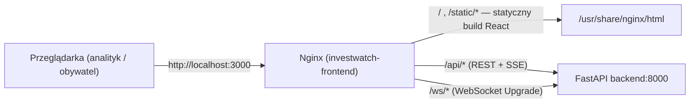
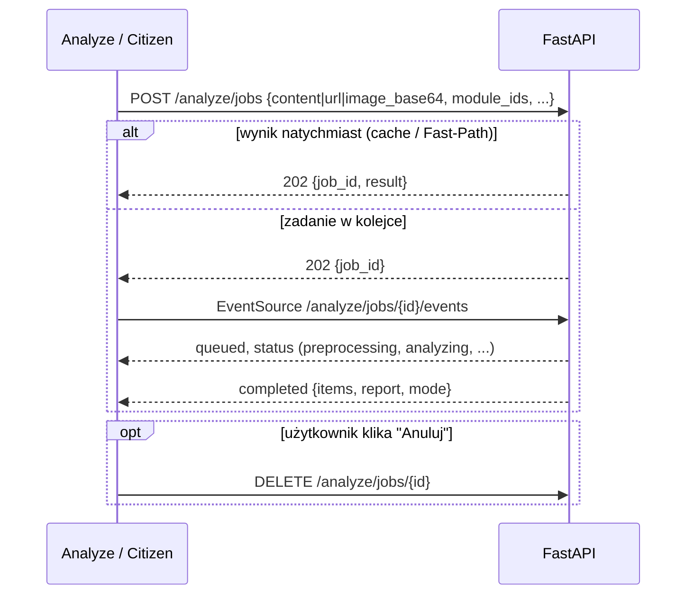

# Architektura i Implementacja Frontendu `Ryziqo`

Opis techniczny panelu `Ryziqo` (HackNation UKNF 2026) — aplikacji **React 19** z dwoma widokami: **panelem analityka UKNF** i **publicznym formularzem obywatela** (`/public`). W produkcji serwowana przez **Nginx**, który pełni też rolę reverse proxy do backendu. Kontrakt danych: [CONTRACT.md](../CONTRACT.md) (`1.4.0`).

> Prototyp frontendu został wygenerowany w środowisku Emergent, a następnie oczyszczony z jego integracji (telemetria, skrypty zewnętrzne, pakiety `@emergentbase/*`) — patrz [§9](#9-bezpieczeństwo-i-prywatność). Notatki projektowe z tego etapu (dokumenty historyczne): [frontend/PRD.md](./frontend/PRD.md), [frontend/plan.md](./frontend/plan.md), [frontend/design_guidelines.json](./frontend/design_guidelines.json).

**Spis treści**

1. [Topologia uruchomieniowa](#1-topologia-uruchomieniowa-docker-compose)
2. [Struktura katalogu `frontend/`](#2-struktura-katalogu-frontend)
3. [Konfiguracja (`REACT_APP_*`)](#3-konfiguracja-react_app_)
4. [Widoki i routing](#4-widoki-i-routing)
5. [Warstwa stanu i tryby pracy](#5-warstwa-stanu-i-tryby-pracy-libstorejs)
6. [Komunikacja z backendem](#6-komunikacja-z-backendem)
7. [Dane w przeglądarce (`localStorage`)](#7-dane-w-przeglądarce-localstorage)
8. [Build i konteneryzacja](#8-build-i-konteneryzacja)
9. [Bezpieczeństwo i prywatność](#9-bezpieczeństwo-i-prywatność)
10. [Konwencje i rozwój](#10-konwencje-i-rozwój)
11. [Uruchomienie i weryfikacja](#11-uruchomienie-i-weryfikacja)
12. [Znane ograniczenia](#12-znane-ograniczenia)

---

## 1. Topologia uruchomieniowa (Docker Compose)



- Przeglądarka komunikuje się **wyłącznie z jednym originem** (`localhost:3000`). Frontend jest budowany z `REACT_APP_INVESTWATCH_API_URL=/api/v1`, więc REST, SSE i WebSocket idą przez Nginx — bez CORS i bez problemu *mixed content*.
- Serwis `frontend` startuje dopiero, gdy `backend` przejdzie `HEALTHCHECK` (`depends_on: condition: service_healthy`).
- W developmencie lokalnym (`yarn start`, port `3000`) frontend łączy się bezpośrednio z `http://localhost:8000/api/v1` — backend musi wtedy dopuszczać ten origin w `CORS_ORIGINS` (domyślnie dopuszcza).

---

## 2. Struktura katalogu `frontend/`

```text
frontend/
├── Dockerfile                    # multi-stage: node:20-alpine (yarn build) -> nginx:1.27-alpine
├── nginx.conf                    # proxy /api/ i /ws/ -> backend:8000, SPA fallback, cache, gzip
├── nginx-security-headers.conf   # wspólne nagłówki bezpieczeństwa (include w każdej location)
├── .dockerignore                 # node_modules, build, .env (sekrety nie trafiają do obrazu)
├── .env.example                  # szablon zmiennych REACT_APP_* (właściwy .env ignorowany przez Git)
├── package.json / yarn.lock      # Yarn 1.22, CRA 5 (react-scripts) + craco
├── craco.config.js               # alias "@" -> src, ESLint react-hooks, kompatybilność z webpack-dev-server 5
├── tailwind.config.js, postcss.config.js, components.json (shadcn/ui)
├── public/index.html
└── src/
    ├── App.js                    # routing (react-router 7), AppProvider, Sidebar/Header, DemoBanner, Toaster
    ├── App.css, index.css        # style globalne, klasy pomocnicze (.focus-ring, .compact-action), @media print
    ├── pages/
    │   ├── Dashboard.jsx         # "/"               — KPI, trend, live log, przegląd zagrożeń, rejestr incydentów
    │   ├── Citizen.jsx           # "/public"         — formularz obywatela: tekst / URL / zrzut, zgoda na udostępnienie
    │   ├── Analyze.jsx           # "/analyze"        — analiza tekstu / URL / zrzutu z postępem (SSE), przykłady demo
│   ├── Crawler.jsx           # "/crawler"        — nowy skan, zadania kolejki, watchlista, discovery
    │   ├── IncidentDetail.jsx    # "/incidents/:id"  — reguły, cytaty, wersje strony, klony, paczka dowodowa, druk A4
    │   ├── Intelligence.jsx      # "/reports", "/reports/:id", "/campaigns", "/diagnostics" + ThreatOverview
    │   ├── Graph.jsx             # "/graph"          — mapa powiązań (d3-force, SVG)
    │   ├── Calibration.jsx       # "/calibration"    — etykiety referencyjne, macierz TP/FP/TN/FN, próg
    │   └── LogPage.jsx           # "/log"            — pełny dziennik zdarzeń (REST/WS/demo)
    ├── components/
    │   ├── Header.jsx            # Sidebar (desktop), MobileNavigation (Sheet), przełącznik Analityk/Obywatel, PL/EN, status połączenia
    │   ├── DemoBanner.jsx        # pasek trybu DEMO z przyczyną i przyciskiem "Ponów połączenie"
    │   ├── IncidentTable.jsx     # rejestr incydentów + eksport CSV/JSON
    │   ├── TrendChart.jsx        # wykres trendu (Recharts) per moduł
    │   ├── LiveLog.jsx           # Live Crawler Log (zdarzenia WS i lokalne)
    │   ├── Badges.jsx            # RiskScore, ModuleTag, StatusBadge, DemoTag, Panel
    │   ├── Logo.jsx
    │   ├── ErrorBoundary.jsx     # błąd renderowania strony nie wywraca całego panelu
    │   └── ui/                   # shadcn/ui (Radix + Tailwind): tylko używane slider i sheet
    ├── lib/
    │   ├── config.js             # API_URL, WS_URL, ALERT_THRESHOLD, MODULES, STATUSES, riskLevel()
    │   ├── api.js                # klient REST + SSE (fetch z timeoutem, EventSource)
    │   ├── store.js              # AppProvider: tryb online/demo, incydenty, WebSocket, zdarzenia, adnotacje, i18n
    │   ├── demoEngine.js         # jawny analizator regułowy trybu DEMO (bez AI)
    │   ├── exportRegister.js     # eksport rejestru do CSV (ochrona przed CSV injection) / JSON
    │   ├── samples.js            # przykłady S1–S6 do demonstracji Modułów 1–3 (z etykietą referencyjną)
    │   ├── i18n.js               # słowniki PL / EN, RULE_LABELS, formatDate, platformLabel
    │   └── utils.js              # cn() (clsx + tailwind-merge), formatRiskPercent()
```

---

## 3. Konfiguracja (`REACT_APP_*`)

CRA wkleja zmienne do bundla **w czasie builda** — zmiana wymaga przebudowania obrazu (`docker compose up --build`) albo restartu `yarn start`.

| Zmienna | Dev lokalny (`frontend/.env`) | Docker (build arg w `docker-compose.yml`) | Opis |
|---|---|---|---|
| `REACT_APP_INVESTWATCH_API_URL` | `http://localhost:8000/api/v1` | `/api/v1` | Bazowy adres REST. Może być pełnym URL albo ścieżką relatywną. |
| `REACT_APP_ALERT_THRESHOLD` | `0.7` | `${HIGH_RISK_ALERT_THRESHOLD:-0.65}` | Próg `risk_score`, od którego panel pokazuje alert (toast) i liczy KPI „wysokie ryzyko”. W Dockerze spójny z progiem backendu. |
| `FRONTEND_PORT` (root `.env`) | — | `3000` | Port hosta, na którym Nginx wystawia panel. |

Adres WebSocket jest wyliczany w `config.js` z `API_URL`: `http(s)://host/api/v1` → `ws(s)://host/ws/alerts`. Ścieżka relatywna jest najpierw rozwiązywana względem `window.location.origin`.

**Poziomy ryzyka w UI** (`riskLevel()` w `config.js`): `high` ≥ 0,70, `medium` ≥ 0,40, `low` poniżej. Wartości wyświetlane są jako procenty całkowite (`formatRiskPercent()`, np. `0.83` → `83%`). Uwaga: incydenty mają `risk_score` w skali 0–1, a wpisy bazy zgłoszeń (`/intelligence/reports`) w skali 0–100 — `Intelligence.jsx` dzieli je przez 100 przed wyświetleniem.

---

## 4. Widoki i routing

Routing definiuje `src/App.js`. Wszystkie widoki poza `/public` mają boczną nawigację (`Sidebar`, na ekranach < 1024 px — szuflada `Sheet`). Przełącznik **Analityk / Obywatel** w nagłówku przechodzi między `/` a `/public`.

| Ścieżka | Komponent | Dla kogo | Tryb DEMO | Główne dane |
|---|---|---|---|---|
| `/` | `Dashboard` | analityk | ✔ (bez `ThreatOverview`) | lista incydentów ze `store`, `/intelligence/diagnostics`, `/intelligence/reports?limit=5` |
| `/public` | `Citizen` | obywatel | ✔ tylko tekst | `POST /analyze/jobs` lub `/analyze/text` / `/analyze/url` |
| `/analyze` | `Analyze` | analityk | ✔ tylko tekst | `POST /analyze/jobs` + SSE |
| `/crawler` | `Crawler` | analityk | ✘ | `GET /crawl/jobs`, `POST /crawl/trigger`, `/watchlist/*`, `/discovery/*` |
| `/incidents/:id` | `IncidentDetail` | analityk | ✔ (bez wersji, klonów, paczki dowodowej) | `GET /incidents/{id}`, `/similar`, `/versions`, `/evidence-pack` |
| `/reports` | `Reports` | analityk | ✘ | `GET /intelligence/reports` |
| `/reports/:id` | `ReportDetails` | analityk | ✘ | `GET`/`PATCH /intelligence/reports/{id}` |
| `/campaigns` | `Campaigns` | analityk | ✘ | `GET /intelligence/campaigns`, `PATCH /intelligence/campaigns/{id}` |
| `/graph` | `Graph` | analityk | ✔ (graf lokalny) | `GET /intelligence/graph?min_score=` |
| `/diagnostics` | `Diagnostics` | analityk | ✘ | `GET /intelligence/diagnostics` (odświeżanie co 3 s) |
| `/calibration` | `Calibration` | analityk | ✔ | lista incydentów ze `store` (liczone w przeglądarce) |
| `/log` | `LogPage` | analityk | ✔ | zdarzenia ze `store` |

### 4.1. Pulpit (`/`)
- Filtr modułów (Wszystkie / M1 / M2 / M3) działa na liście incydentów w pamięci.
- KPI: wszystkie, wysokie ryzyko (≥ `ALERT_THRESHOLD`), otwarte (`new`, `in_review`, `referred`), potwierdzone.
- `TrendChart` (Recharts) i `LiveLog` (10 ostatnich zdarzeń).
- `ThreatOverview` (z `Intelligence.jsx`, tylko online): liczba zgłoszeń, potwierdzonych fake'ów, aktywnych kampanii, szacowany czas zaoszczędzony dzięki cache / Fast-Path oraz 5 ostatnich zgłoszeń (odświeżanie co 15 s).
- `IncidentTable` z eksportem rejestru do **CSV** lub **JSON** (`lib/exportRegister.js`; plik `ryziqo-RRRR-MM-DD.{csv,json}`). CSV ma BOM UTF-8, a komórki zaczynające się od `= + - @` są poprzedzane apostrofem (ochrona przed *CSV/formula injection* w Excelu).

### 4.2. Formularz obywatela (`/public`)
Uproszczony widok bez nawigacji panelu, wysyłany z `source_channel: "public_form"` (backend maskuje wtedy PESEL i numery kart przed analizą).
- **Kanały:** tekst (min. 20 znaków), adres URL, zrzut ekranu (PNG / JPEG / WebP, maks. 10 MiB). W trybie DEMO URL wymaga wklejenia transkrypcji, a zrzut jest niedostępny.
- **Zgoda na udostępnienie** (`share_mode`, CONTRACT §3, od `1.4.0`):
  - `none` — „tylko sprawdź”: werdykt bez zapisu w rejestrze; wynik nie trafia do listy incydentów w panelu;
  - `anonymous` (domyślnie) — zapis bez IP i User-Agent zgłaszającego;
  - `signed` — pseudonim (do 40 znaków) + losowy `reporter_key` przeglądarki (`crypto.randomUUID()` z fallbackiem na `getRandomValues`), zapamiętywany w `localStorage`, by łączyć zgłoszenia jednej osoby bez zakładania konta. Backend przechowuje tylko HMAC klucza.
- **Werdykt:** poziom ryzyka (najwyższy z wyników modułów), do 3 najważniejszych sygnałów (etykiety reguł z `RULE_LABELS`, uzasadnienia, cytaty), link do listy ostrzeżeń publicznych KNF przy wysokim ryzyku. Dopasowanie w bazie potwierdzonych fake'ów (`report.result_origin === "fast_path"`) wymusza poziom wysoki i pokazuje streszczenie z bazy.
- Incydenty zgłoszone przez obywatela są oznaczane lokalnie flagą `citizen: true` (kolumna `citizen` w eksporcie) i **nie** generują toastu alertu.

### 4.3. Nowa analiza (`/analyze`)
- Zakładki **Tekst** (z wyborem przykładu S1–S6, maks. 20 000 znaków), **URL** i **Zrzut ekranu** (wybór pliku, przeciągnij-upuść lub wklejenie ze schowka `Ctrl+V`).
- Wybór modułów (min. jeden), opcjonalnie platforma publikacji i **„wymuś pełną analizę”** (`force_full` — pomija cache i Fast-Path).
- W trybie online analiza idzie przez kolejkę zadań: postęp etapów (`queued`, `status`) jest pokazywany na żywo, a przycisk **Anuluj** przerywa zadanie (`DELETE /analyze/jobs/{id}`) — patrz [§6.2](#62-kolejka-analizy-i-postęp-sse).
- Przykłady demo są wysyłane z `source_url: "manual://sample/S1…S6"` i `ground_truth_label` — backend deduplikuje je po `content_hash`, a panel oznacza je etykietą „PRZYKŁAD”.

### 4.4. Karta incydentu (`/incidents/:id`)
Przy wejściu dociągany jest pełny `IncidentDetail` (lista go nie zawiera). Sekcje:
- **Baner prompt injection** — gdy jest reguła `AI_PROMPT_INJECTION`: wykryte polecenia dla systemu oceny (`prompt_injection_snippets`) i tekst ukryty przed użytkownikiem (`hidden_text_snippets`).
- **Naruszone reguły** — `rule_id`, nazwa, waga (kropka koloru), uzasadnienie i podstawa prawna.
- **Cytaty dowodowe** z plakietką strażnika anty-halucynacyjnego (`quote_checks`: `exact` / `fuzzy` / `missing` / `system`; offline — sprawdzenie dosłownego wystąpienia w tekście) oraz **materiał źródłowy** z podświetleniem cytatów.
- **Historia wersji strony** (online) — kolejne wersje z informacją o ostrzeżeniu o ryzyku i jego rozmiarze; alert, gdy ostrzeżenie usunięto lub zmniejszono (`warning_change`), oraz diff zdań usuniętych / dodanych.
- **Panel sprawy:** status (`STATUSES`), etykieta referencyjna (naruszenie / brak / bez etykiety), notatka analityka, **paczka dowodowa ZIP** (online; `GET /incidents/{id}/evidence-pack` — HTML źródła, ekstrakcja, zrzuty, manifest SHA-256, opcjonalnie znacznik czasu RFC 3161), **druk A4** (`window.print()`).
- **Podmiot** — nazwa, promotor, status w rejestrze KNF, data snapshotu rejestru.
- **Metryki DOM/CSS** (Moduł 2) — rozmiar czcionki dominującej vs. ostrzeżenia, ukrycie w stopce, wymagane kliknięcie, niski kontrast, przepełnienie mobilne.
- **Podobne decyzje / klony** (online, `GET /incidents/{id}/similar`) — podobieństwo w %, plakietka KLON, decyzja i notatka analityka.
- **Metadane techniczne zgłoszenia** (online, `IncidentEvidence`) — źródło wyniku (Fast-Path / cache / Ollama / reguły), łańcuch przekierowań, IP / ASN / kraj hostingu (DB-IP, CC BY 4.0), SHA-256, pHash, kampania; przycisk kopiujący paczkę tekstową dla CERT / KNF do schowka.

Wydruk: klasy `.no-print` / `.print-only` (`App.css`, `@media print`) ukrywają nawigację, banery i panel sprawy, a dodają nagłówek z logo oraz pola na datę i podpis.

### 4.5. Baza zgłoszeń, kampanie, diagnostyka (`Intelligence.jsx`)
Widoki wymagają backendu (w DEMO pokazują komunikat „Rejestr wymaga połączenia z backendem”). Dane pobiera wspólny hook `useData(path, interval)` przez `backend.intel()`.
- **`/reports`** — wyszukiwanie (domena, treść, IP serwera, podmiot, URL), filtr statusu, stronicowanie po 50, filtr `?campaign=<id>` (link z kampanii i mapy).
- **`/reports/:id`** — wynik analizy (skala 0–100), powiązane incydenty, metadane techniczne, **ocena analityka**: status zgłoszenia (`new`, `confirmed_fake`, `requires_review`, `false_positive`) i notatka (do 4000 znaków). Status `confirmed_fake` zasila Fast-Path — kolejne identyczne zgłoszenia dostają gotowy werdykt bez LLM.
- **`/campaigns`** — grupy ≥ 2 powiązanych zgłoszeń (domena / IP / liczba członków) z możliwością nadania statusu całej kampanii jednym kliknięciem.
- **`/diagnostics`** — model Ollama i jego dostępność, aktywne / oczekujące zadania kolejki FIFO (pojemność 8), trafienia cache i Fast-Path.

### 4.6. Mapa powiązań (`/graph`)
- Graf siłowy `d3-force` renderowany w SVG (bez Canvas/WebGL): przybliżanie kółkiem, przesuwanie tła, przeciąganie węzłów, podświetlenie sąsiadów po najechaniu, kliknięcie incydentu → karta incydentu, kliknięcie kampanii → `/reports?campaign=`.
- Typy węzłów i krawędzi zgodne z `GET /intelligence/graph` (CONTRACT §3); legenda z licznikami. Rozmiar węzła incydentu rośnie z `risk_score`. Filtr minimalnego ryzyka: 0 / 30 / 50 / 70%. Gdy backend obciął graf (`truncated`), widoczna jest informacja.
- **DEMO:** graf budowany lokalnie z incydentów (`localGraph()`): incydent ↔ domena publikacji / promotor / podmiot, z pominięciem fałszywych alarmów.

### 4.7. Kalibracja (`/calibration`) i dziennik (`/log`)
- Macierz TP/FP/TN/FN, precyzja/czułość i wykres FP/FN w funkcji progu liczone są w przeglądarce z `risk_score` i `ground_truth_label` (funkcja `confusion()`), więc działają identycznie w obu trybach. Przycisk „Przeanalizuj przykłady” wysyła brakujące S1–S6. Licznik „Decyzje analityków użyte przez RAG” to liczba incydentów z etykietą lub statusem `confirmed` / `false_positive` (liczony lokalnie; `GET /stats` nie jest używany).
- `/log` — pełny `LiveLog` (do 300 zdarzeń w pamięci), z czyszczeniem i symulacją cyklu crawlera w trybie DEMO.

### 4.8. Crawler (`/crawler`)
Widok wymaga backendu (w DEMO komunikat z odesłaniem do symulacji w `/log`).
- **Nowy skan** — publiczny URL (walidacja anty-SSRF po stronie backendu, błąd `400` pokazany wprost), głębokość podstron 0–2, limit stron (1–30), moduły, opcjonalny render Playwright; przycisk **„Skanuj strony demo”** z listą: wszystkie strony demo (`mode: "mock_all"`) albo jedna wybrana (`mode: "mock_single"`, `mock_file` z `available_mock_files`). Duplikat w kolejce (`409`) daje czytelny komunikat.
- **Zadania crawlera** — 25 ostatnich zadań z `GET /crawl/jobs`: status, cel, źródło (ręcznie / watchlista / discovery), liczba stron i wyników, uwagi (błąd pobrania z nazwą hosta, pominięcie przez `robots.txt`) oraz termin następnego skanu harmonogramu. Odświeżanie co 4 s, gdy coś jest w kolejce lub w trakcie (inaczej co 20 s), i od razu po zdarzeniach WebSocket `crawler_status:*`, `analysis_complete`, `error`.
- **Watchlista** — dodawanie (URL, opis, głębokość), włączanie / wyłączanie skanu okresowego, usuwanie (z potwierdzeniem), „Skanuj” pojedynczego źródła (`origin: "watchlist"`), „Skanuj wszystkie teraz” (`POST /watchlist/run`) i „Dodaj źródła startowe” (`POST /watchlist/seed`). Kolumna **„Ostatni skan”** to najnowsze zadanie z listy zadań dla tego samego kanonicznego URL-a (status, czas, błąd).
- **Discovery** — przy `DISCOVERY_ENABLED=true` przycisk „Uruchom discovery” (`POST /discovery/run`) i ostatnio znalezione adresy (`GET /discovery/recent`); w przeciwnym razie instrukcja włączenia profilu SearXNG.

---

## 5. Warstwa stanu i tryby pracy (`lib/store.js`)

Cały stan współdzielony trzyma `AppProvider` (React Context, hook `useApp()`); nie ma Reduxa, a React Query nie jest wykorzystywany (patrz [§12](#12-znane-ograniczenia)).

1. **Start:** `GET /health`, a następnie `GET /incidents?limit=500` (zapamiętuje też `knf_snapshot_date`).
2. **Tryb `online`:** dane z backendu, otwarty WebSocket `/ws/alerts` z ponawianiem połączenia (backoff wykładniczy `2^n s`, maks. 5 prób, potem status `offline` bez dalszego zalewania konsoli błędami). Przy przeładowaniu listy zachowywane są wcześniej pobrane pola `IncidentDetail` (`raw_text_preview`, `quote_checks`, `prompt_injection_snippets`, `hidden_text_snippets`).
3. **Tryb `demo`:** gdy backend nie odpowiada (lub strona HTTPS wskazuje na API HTTP — *mixed content*), panel przełącza się na **jawny analizator regułowy** w przeglądarce (`demoEngine.js`: słowa-klucze dla Modułów 1–3, cytaty wycinane dosłownie z tekstu). Tworzy on rekordy **w tym samym kształcie `Incident` co backend** (`is_demo_fallback: true`, `model_used: "demo-heuristic-v1 (przeglądarka)"`), trzymane w `localStorage`. `DemoBanner` pokazuje przyczynę i adres API; „Ponów połączenie” wywołuje ponownie `connect()`.
4. **Adnotacje lokalne (`annotate`)** — nakładane na rekordy z backendu i zapisywane w `localStorage` (`investwatch.casework.v1`): notatka analityka (`analyst_note`), status `referred` (przekazane — backend nie ma tego statusu), flaga `citizen`. Pozostałe statusy i etykieta idą do backendu (`PATCH /status`, `PATCH /label`), a w DEMO są zmieniane lokalnie.
5. **Alerty:** incydent z `risk_score ≥ ALERT_THRESHOLD` generuje jednorazowy toast (deduplikacja po `id`); dla reguły `M2_MONETARY_OFFER` opis wskazuje ofertę „dochodu w określonym czasie”.
6. **i18n:** PL (domyślnie) / EN, wybór zapamiętany w `localStorage` i ustawiany w `<html lang>`.

Kontekst udostępnia m.in.: `mode`, `demoReason`, `wsStatus`, `incidents`, `events`, `knfSnapshotDate`, `lang`, `t()`, `setLang()`, `connect()`, `analyze()`, `refreshIncident()`, `updateStatus()`, `setGroundTruth()`, `annotate()`, `analyzeSamples()`, `runCycle()`, `clearDemo()`, `clearEvents()`.

---

## 6. Komunikacja z backendem

### 6.1. Endpointy używane przez panel

Klient: `src/lib/api.js` (`fetch` z `AbortController`, domyślny timeout 90 s; błąd ma `message` z pola `detail` odpowiedzi i `status` HTTP).

| Funkcja panelu | Endpoint / zdarzenie |
|---|---|
| Sprawdzenie dostępności backendu (timeout 2,5 s) | `GET /api/v1/health` |
| Rejestr incydentów, pulpit, trend, kalibracja | `GET /api/v1/incidents?limit=500` |
| Karta incydentu | `GET /api/v1/incidents/{id}` |
| Podobne decyzje / klony | `GET /api/v1/incidents/{id}/similar` |
| Historia wersji strony | `GET /api/v1/incidents/{id}/versions` |
| Paczka dowodowa ZIP | `GET /api/v1/incidents/{id}/evidence-pack` |
| Zmiana statusu sprawy / etykieta referencyjna | `PATCH /api/v1/incidents/{id}/status`, `PATCH /api/v1/incidents/{id}/label` |
| Analiza z postępem (tekst / URL / zrzut) | `POST /api/v1/analyze/jobs` → SSE `GET /api/v1/analyze/jobs/{id}/events`, anulowanie `DELETE /api/v1/analyze/jobs/{id}` |
| Analiza bez postępu (przykłady, kalibracja) | `POST /api/v1/analyze/text`, `POST /api/v1/analyze/url` (zrzut: `image_base64` w `/analyze/text`, timeout 305 s) |
| Baza zgłoszeń | `GET /api/v1/intelligence/reports`, `GET`/`PATCH /api/v1/intelligence/reports/{id}` |
| Kampanie | `GET /api/v1/intelligence/campaigns`, `PATCH /api/v1/intelligence/campaigns/{id}` |
| Mapa powiązań | `GET /api/v1/intelligence/graph?min_score=` |
| Diagnostyka i przegląd zagrożeń | `GET /api/v1/intelligence/diagnostics` |
| Crawler, watchlista, discovery | `GET /api/v1/crawl/jobs`, `POST /api/v1/crawl/trigger`, `GET`/`POST /api/v1/watchlist`, `PATCH`/`DELETE /api/v1/watchlist/{id}`, `POST /api/v1/watchlist/run`, `POST /api/v1/watchlist/seed`, `GET /api/v1/discovery/recent`, `POST /api/v1/discovery/run` |
| Live Crawler Log i alerty | WebSocket `/ws/alerts`: `crawler_status` (→ wpis `crawler_status:<stage>`), `high_risk_alert` (→ pobranie incydentu i toast), `status_updated` (→ odświeżenie incydentu), `analysis_complete` (→ odświeżenie listy), `error`, `pong` (ignorowany) |

Każde żądanie analizy niesie `source_channel` (`analyst_panel` lub `public_form`), a z formularza obywatela także pola zgody (`share_mode`, `reporter_display_name`, `reporter_key`). Odpowiedź zawiera `items` (incydenty, `risk_score` 0–1) i `report` (podsumowanie, `risk_score` 0–100, `result_origin`).

**Nieużywane przez panel** (dostępne przez API / Swagger): `GET /stats`, `reports/{module_id}`, `knf-registry`, `rules` — patrz [§12](#12-znane-ograniczenia).

### 6.2. Kolejka analizy i postęp (SSE)



- `streamAnalysis()` zamienia plik obrazu na Base64 (`FileReader`), wysyła zadanie i nasłuchuje zdarzeń `queued` / `status` / `completed`. Przejściowe zerwanie połączenia (`readyState === CONNECTING`) jest ignorowane — `EventSource` sam się wznawia; inne błędy kończą analizę komunikatem.
- Pełna kolejka zwraca `429` — UI pokazuje komunikat błędu z pola `detail`. Nginx ma `proxy_buffering off` dla `/api/`, więc zdarzenia SSE docierają od razu.

---

## 7. Dane w przeglądarce (`localStorage`)

| Klucz | Zawartość | Kiedy |
|---|---|---|
| `investwatch.lang` | `pl` / `en` | zawsze |
| `investwatch.demo.incidents.v2` | incydenty utworzone w trybie DEMO | tylko DEMO |
| `investwatch.casework.v1` | adnotacje per incydent: `analyst_note`, `status: "referred"`, `citizen` | zawsze |
| `investwatch.reporter_key` | losowy klucz przeglądarki do zgłoszeń podpisanych | po pierwszym zgłoszeniu `signed` |
| `investwatch.reporter_name` | ostatnio użyty pseudonim zgłaszającego | po zgłoszeniu `signed` |

Każdy odczyt/zapis jest w `try/catch` — w trybie prywatnym lub przy zablokowanych danych witryny aplikacja działa, a dane żyją tylko do końca sesji. Dane te nie są synchronizowane między przeglądarkami ani analitykami.

---

## 8. Build i konteneryzacja

- **`frontend/Dockerfile`:**
  - Etap `build` (`node:20-alpine`): `yarn install --frozen-lockfile` (warstwa cache'owana po `package.json` + `yarn.lock`), następnie `yarn build` z `GENERATE_SOURCEMAP=false` (kod źródłowy nie jest publikowany w obrazie).
  - Etap końcowy (`nginx:1.27-alpine`): wyłącznie statyczny `build/` + konfiguracja Nginx, `HEALTHCHECK` (`wget` na `/`). Obraz nie zawiera Node.js, `node_modules` ani plików `.env`.
- **`frontend/nginx.conf`:**
  - `location = /api/v1/analyze/text` — `client_max_body_size 14m` (zrzut ekranu ≤ 10 MiB w Base64), `proxy_read_timeout 300s` (analiza VLM/OCR).
  - `location /api/` — proxy do `backend:8000` z nagłówkami `X-Forwarded-*`, `client_max_body_size 14m`, `proxy_buffering off` (SSE kolejki analizy), `proxy_read_timeout 120s`.
  - `location /ws/` — proxy WebSocket (`Upgrade`/`Connection`), timeout `3600s` dla długotrwałych połączeń alertów.
  - `location /static/` — hashowane assety CRA z `Cache-Control: public, immutable` (1 rok).
  - `location /` — SPA fallback (`try_files ... /index.html`) z `Cache-Control: no-cache`, dzięki czemu bezpośrednie wejście na `/incidents/:id`, `/reports/:id` czy `/public` działa.
  - Domyślnie `client_max_body_size 1m`, `gzip`, `server_tokens off`.

---

## 9. Bezpieczeństwo i prywatność

- **Brak telemetrii i skryptów firm trzecich:** z `public/index.html` usunięto PostHog z **nagrywaniem sesji** (wysyłka do `ap.emergent.sh`) oraz skrypt `assets.emergent.sh`; z zależności usunięto `@emergentbase/overlay` i `@emergentbase/visual-edits` (pobierane z serwerów Emergent w czasie builda). Zweryfikowano, że zbudowany bundel nie zawiera odwołań `emergent` / `posthog`.
- **Nagłówki bezpieczeństwa (Nginx):** `X-Content-Type-Options: nosniff`, `X-Frame-Options: DENY`, `Referrer-Policy: strict-origin-when-cross-origin` — dołączane snippetem w każdej `location` (dyrektywa `add_header` w `location` nie dziedziczy nagłówków z poziomu `server`).
- **Sekrety:** `frontend/.env` jest ignorowany przez Git i wykluczony z kontekstu builda (`.dockerignore`); w repo jest tylko `frontend/.env.example`. Zmienne `REACT_APP_*` są **publiczne** (trafiają do bundla) — nie wolno w nich umieszczać sekretów.
- **Dane zgłaszających:** formularz obywatela domyślnie wysyła zgłoszenie anonimowe; IP, User-Agent i skróty identyfikatorów nie są zwracane przez API bazy zgłoszeń. Pseudonim i klucz przeglądarki są wysyłane tylko przy świadomym wyborze `signed`.
- **Eksport CSV:** neutralizacja formuł arkusza (prefiks `'`) i poprawne cytowanie pól.
- **Pozostałe połączenia zewnętrzne:** fonty IBM Plex z Google Fonts (`fonts.googleapis.com`) oraz linki (bez pobierania danych) do listy ostrzeżeń KNF i DB-IP. Przy wdrożeniu w pełni offline / on-premise fonty należy hostować lokalnie (np. pakiety `@fontsource/ibm-plex-*`).
- **Brak uwierzytelniania** — panel analityka i formularz obywatela są w tym samym bundlu i korzystają z tego samego API bez logowania. Na produkcji widoki analityka wymagają osłony (SSO / reverse proxy z uwierzytelnianiem).
- Wyniki audytu zależności: [security-licenses.md](./security-licenses.md#4-wynik-audytu-yarn-audit-frontend).

---

## 10. Konwencje i rozwój

- **Import aliasowany:** `@/` → `src/` (`craco.config.js`, `jsconfig.json`).
- **Stylowanie:** Tailwind + komponenty `shadcn/ui` w `components/ui/`. Paleta: granat `#0B192C` / `#0A1E33` (nawigacja), kolory modułów `MODULE_COLORS` (M1 niebieski, M2 bursztynowy, M3 czerwony). Fokus klawiatury: klasa `.focus-ring`. Przyciski pomocnicze: `.compact-action`.
- **Teksty:** każdy tekst UI przez `t("klucz")` ze słowników w `lib/i18n.js` (PL i EN muszą mieć ten sam klucz). Wyjątek: widoki `Intelligence.jsx` i `Graph.jsx` używają lokalnego pomocnika `l(pl, en)`.
- **Dostępność:** `aria-label` dla nawigacji i grup przycisków, `role="status"` / `role="alert"` dla komunikatów, `aria-pressed` / `aria-selected` dla przełączników i zakładek.
- **`data-testid`:** kebab-case (np. `incident-print-button`, `analyze-submit-button`).
- **Dodanie nowego widoku:**
  1. komponent w `src/pages/`,
  2. `<Route>` w `src/App.js`,
  3. wpis w `LINKS` w `components/Header.jsx` (ścieżka, klucz i18n, `data-testid`, ikona `lucide-react`),
  4. klucze tłumaczeń PL i EN w `lib/i18n.js`,
  5. obsługa trybu DEMO (komunikat lub dane lokalne) — widok nie może zakładać, że backend działa.
- **Dodanie wywołania API:** nowa metoda w obiekcie `backend` (`lib/api.js`) i wpis w tabeli [§6.1](#61-endpointy-używane-przez-panel); endpoint musi być opisany w [CONTRACT.md](../CONTRACT.md) (zmiany wyłącznie addytywne).

---

## 11. Uruchomienie i weryfikacja

```bash
# Docker (razem z backendem) — panel: http://localhost:3000, formularz obywatela: http://localhost:3000/public
docker compose up --build -d

# Dev lokalny (hot-reload), backend na :8000
cd frontend
cp .env.example .env
yarn install
yarn start

# Build produkcyjny z ESLint jako błędem
CI=true yarn build
```

**Stan weryfikacji (`2026-11-21`, przed dodaniem widoków `/public`, `/graph`, bazy zgłoszeń i paczki dowodowej):**
- `docker compose up --build` — oba kontenery `healthy`; `GET /` i ścieżki SPA → `200`; `GET /api/v1/health` przez Nginx → `200`; `/ws/alerts` → `101 Switching Protocols`.
- `yarn start` — `Compiled successfully!`; `CI=true yarn build` — bez ostrzeżeń ESLint.
- Przez Nginx: `POST /api/v1/analyze/text` → incydent zgodny z kontraktem; `POST /api/v1/analyze/url` → `400` dla adresu wewnętrznego (`http://backend:8000/...`), `200` dla publicznej strony; `PATCH /label` zapisuje etykietę.

**Scenariusz ręcznego testu E2E w przeglądarce:**
1. Start: `BACKEND ONLINE · WS połączony`, brak paska DEMO, czysta konsola.
2. Pulpit: KPI, przegląd zagrożeń, rejestr incydentów, filtr modułów M1/M2/M3, eksport CSV i JSON.
3. Karta incydentu: naruszone reguły z podstawą prawną, cytaty z plakietkami weryfikacji i podświetlenia w tekście źródłowym, panel DOM/CSS (Moduł 2), status KNF, historia wersji, podobne decyzje; zmiana statusu, etykiety i notatki przetrwa odświeżenie strony; pobranie paczki dowodowej ZIP; wydruk A4.
4. Nowa analiza: przykład tekstowy (postęp etapów, wynik, toast przy wysokim ryzyku, brak duplikatu przy ponownej analizie), anulowanie w trakcie, walidacja braku modułu, URL `http://127.0.0.1/` → komunikat anty-SSRF, URL publiczny → wynik, zrzut ekranu (wklejenie `Ctrl+V`).
5. Formularz obywatela (`/public`): tekst, URL, zrzut; tryby „tylko sprawdź” (brak wpisu w rejestrze), anonimowy i podpisany (wymagany pseudonim).
6. Baza zgłoszeń, kampanie (status dla całej grupy), mapa powiązań (filtr ryzyka, przejście do incydentu), diagnostyka.
7. Kalibracja: analiza 6 przykładów z etykietami, przeliczanie macierzy i wykresu FP/FN suwakiem.
8. Live Crawler Log: zdarzenia `crawler_status:*`, `high_risk_alert`, `analysis_complete`, `status_updated`.
9. Tryb DEMO po `docker compose stop backend` (analiza tekstu, graf lokalny, komunikaty w widokach wymagających backendu) i powrót do online po „Ponów połączenie”.
10. Przełączanie PL/EN bez surowych kluczy tłumaczeń; nawigacja mobilna (< 1024 px).

**Testy automatyczne frontendu:** brak (elementy kluczowe mają atrybuty `data-testid` pod testy E2E).

---

## 12. Znane ograniczenia

- **Notatka analityka i status „przekazane” (`referred`)** są przechowywane tylko w `localStorage` przeglądarki — nie trafiają do backendu ani do paczki dowodowej i nie są widoczne dla innych analityków. Notatka w bazie zgłoszeń (`/reports/:id`) jest osobnym polem zapisywanym w backendzie.
- **Dwa słowniki statusów:** incydenty (`new`, `in_review`, `referred`, `confirmed`, `false_positive`) i wpisy bazy zgłoszeń (`new`, `confirmed_fake`, `requires_review`, `false_positive`) są niezależne.
- **Filtry pulpitu** (moduł, źródło, poziom ryzyka, daty) działają na liście załadowanej do przeglądarki (do 500 incydentów).
- **Raporty modułów** (`/reports/{module_id}`, CSV/JSON) są pobierane z backendu po wybraniu modułu na pulpicie; eksport pod tabelą obejmuje bieżącą, przefiltrowaną listę z przeglądarki.
- **Watchlista nie przechowuje wyniku ostatniego skanu** — kolumna „Ostatni skan” w `/crawler` jest wyliczana z 25 ostatnich zadań (`GET /crawl/jobs`), więc dla rzadko skanowanych źródeł bywa pusta.
- **Lista incydentów** ładowana jest jednorazowo do 500 rekordów (bez stronicowania po stronie serwera).
- **Teksty `Intelligence.jsx`, `Graph.jsx` i `Crawler.jsx`** są wpisane w komponentach (`l(pl, en)`), a nie w `i18n.js`.
