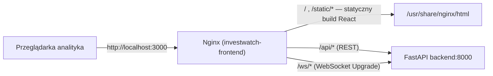

# Architektura i Implementacja Frontendu `#InvestWatch`

Opis techniczny panelu analitycznego `#InvestWatch` (HackNation UKNF 2026) — aplikacji **React 19** dla analityków nadzoru UKNF, serwowanej w produkcji przez **Nginx**, który pełni też rolę reverse proxy do backendu. Kontrakt danych: [CONTRACT.md](../CONTRACT.md).

> Prototyp frontendu został wygenerowany w środowisku Emergent, a następnie oczyszczony z jego integracji (telemetria, skrypty zewnętrzne, pakiety `@emergentbase/*`) — patrz [§7](#7-bezpieczeństwo-i-prywatność). Notatki projektowe z tego etapu: [frontend/PRD.md](./frontend/PRD.md), [frontend/plan.md](./frontend/plan.md), [frontend/design_guidelines.json](./frontend/design_guidelines.json).

---

## 1. Topologia uruchomieniowa (Docker Compose)



- Przeglądarka komunikuje się **wyłącznie z jednym originem** (`localhost:3000`). Frontend jest budowany z `REACT_APP_INVESTWATCH_API_URL=/api/v1`, więc REST i WebSocket idą przez Nginx — bez CORS i bez problemu *mixed content*.
- Serwis `frontend` startuje dopiero, gdy `backend` przejdzie `HEALTHCHECK` (`depends_on: condition: service_healthy`).
- W developmencie lokalnym (`yarn start`, port `3000`) frontend łączy się bezpośrednio z `http://localhost:8000/api/v1` — backend musi wtedy dopuszczać ten origin w `CORS_ORIGINS` (domyślnie dopuszcza).

---

## 2. Struktura katalogu `frontend/`

```text
frontend/
├── Dockerfile                    # multi-stage: node:20-alpine (yarn build) -> nginx:1.27-alpine
├── nginx.conf                    # proxy /api/ i /ws/ -> backend:8000, SPA fallback, cache, gzip
├── nginx-security-headers.conf   # wspólne nagłówki bezpieczeństwa (include w każdej location)
├── .dockerignore                 # node_modules, build, .env (sekrety nie trafiają do obrazu)
├── .env.example                  # szablon zmiennych REACT_APP_* (właściwy .env ignorowany przez Git)
├── package.json / yarn.lock      # Yarn 1.22, CRA 5 (react-scripts) + craco
├── craco.config.js               # alias "@" -> src, ESLint react-hooks, kompatybilność z webpack-dev-server 5
├── tailwind.config.js, postcss.config.js, components.json (shadcn/ui)
├── plugins/health-check/         # opcjonalne endpointy zdrowia dev servera (ENABLE_HEALTH_CHECK=true)
├── public/index.html
└── src/
    ├── App.js                    # routing (react-router 7) + AppProvider + Toaster
    ├── pages/
    │   ├── Dashboard.jsx         # "/"               — KPI, trend, tabela incydentów, live log
    │   ├── Analyze.jsx           # "/analyze"        — analiza tekstu / URL / obrazu, przykłady demo
    │   ├── IncidentDetail.jsx    # "/incidents/:id"  — uzasadnienie, cytaty dowodowe, status, druk A4
    │   ├── Calibration.jsx       # "/calibration"    — etykiety referencyjne, macierz TP/FP/TN/FN, próg
    │   └── LogPage.jsx           # "/log"            — pełny dziennik zdarzeń (REST/WS/demo)
    ├── components/               # Header, DemoBanner, IncidentTable, TrendChart, LiveLog, Badges, Logo
    │   └── ui/                   # komponenty shadcn/ui (Radix UI + Tailwind)
    ├── lib/
    │   ├── config.js             # API_URL, WS_URL, próg alertu, słowniki modułów i statusów
    │   ├── api.js                # klient REST (fetch + timeout/AbortController)
    │   ├── store.js              # AppProvider: tryb online/demo, incydenty, WebSocket, zdarzenia, i18n
    │   ├── demoEngine.js         # jawny analizator regułowy trybu DEMO (bez AI)
    │   ├── samples.js            # przykładowe treści do demonstracji Modułów 1–3
    │   ├── i18n.js               # słowniki PL / EN
    │   └── utils.js
    ├── hooks/use-toast.js
    └── constants/testIds/        # stałe data-testid (kebab-case)
```

---

## 3. Konfiguracja (`REACT_APP_*`)

CRA wkleja zmienne do bundla **w czasie builda** — zmiana wymaga przebudowania obrazu (`docker compose up --build`).

| Zmienna | Dev lokalny (`frontend/.env`) | Docker (build arg w `docker-compose.yml`) | Opis |
|---|---|---|---|
| `REACT_APP_INVESTWATCH_API_URL` | `http://localhost:8000/api/v1` | `/api/v1` | Bazowy adres REST. Może być pełnym URL albo ścieżką relatywną. |
| `REACT_APP_ALERT_THRESHOLD` | `0.7` | `${HIGH_RISK_ALERT_THRESHOLD:-0.65}` | Próg `risk_score`, od którego panel pokazuje alert (toast). W Dockerze spójny z progiem backendu. |
| `ENABLE_HEALTH_CHECK` | `false` | — | Endpointy zdrowia dev servera (tylko `yarn start`). |
| `FRONTEND_PORT` (root `.env`) | — | `3000` | Port hosta, na którym Nginx wystawia panel. |

Adres WebSocket jest wyliczany w `config.js` z `API_URL`: `http(s)://host/api/v1` → `ws(s)://host/ws/alerts`. Ścieżka relatywna jest najpierw rozwiązywana względem `window.location.origin`.

---

## 4. Warstwa stanu i tryby pracy (`lib/store.js`)

1. **Start:** `AppProvider` wywołuje `GET /health`, a następnie `GET /incidents?limit=500`.
2. **Tryb `online`:** dane z backendu, otwarty WebSocket `/ws/alerts` z ponawianiem połączenia (backoff wykładniczy `2^n s`, maks. 5 prób, potem status `offline` bez dalszego zalewania konsoli błędami).
3. **Tryb `demo`:** gdy backend nie odpowiada (lub strona HTTPS wskazuje na API HTTP — *mixed content*), panel przełącza się na **jawny analizator regułowy** (`demoEngine.js`: słowa-klucze dla Modułów 1–3, cytaty wycinane dosłownie z tekstu). Wyniki są oznaczane `is_demo` i etykietą „DEMO — heurystyka, nie AI”, a dane trzymane w `localStorage`. `DemoBanner` pokazuje przyczynę i adres API.
4. **Alerty:** incydent z `risk_score ≥ ALERT_THRESHOLD` generuje jednorazowy toast (deduplikacja po `id`).
5. **i18n:** PL (domyślnie) / EN, wybór zapamiętany w `localStorage` (`investwatch.lang`).

---

## 5. Zgodność z `CONTRACT.md` — znane rozbieżności

Frontend powstał na podstawie **wcześniejszej, roboczej wersji kontraktu** (Emergent). Zamrożony `CONTRACT.md` v1.0.0 i backend różnią się w kilku miejscach, przez co w trybie `online` panel nie wyświetli poprawnie danych z backendu. Do ujednolicenia po stronie frontendu (zgodnie z zasadą „frontend dostosuje się do kontraktu”):

| Obszar | Frontend oczekuje | `CONTRACT.md` / backend |
|---|---|---|
| Moduł | `primary_module` (`"M1"`/`"M2"`/`"M3"`), `module_scores` | `module_id` (`1`/`2`/`3`), `module_name` |
| Podmiot | `entity` (obiekt, `entity.name`) | `entity_name`, `promoter_name`, `knf_registry_status` |
| Treść i dowody | `content`, `quotes`, `findings`, `reasoning` | `content_excerpt`, `evidence_quotes`, `violated_rules[]` (`reason`, `legal_basis`) |
| Etykieta referencyjna | `ground_truth`, `PATCH /incidents/{id}/label` | `ground_truth_label` — **brak endpointu do zmiany etykiety** |
| Znaczniki czasu / źródło | `created_at`, `source_type`, `is_demo`, `analysis_engine` | `detected_at`, `updated_at`, `source_platform`, `is_demo_fallback`, `model_used` |
| Analiza na żądanie | `POST /analyze/text`, `/analyze/url`, `/analyze/image` | **brak** — backend oferuje `POST /crawl/trigger` (kolejka) |
| Zdarzenia WebSocket | `incident.created`, `incident.updated`, `crawler.progress`, `crawler.error`, `heartbeat` | `connected`, `crawler_status`, `high_risk_alert`, `analysis_complete`, `status_updated`, `error`, `pong` |
| Statystyki | liczone po stronie klienta | `GET /stats` (w tym `calibration`) — nieużywane przez frontend |

---

## 6. Build i konteneryzacja

- **`frontend/Dockerfile`:**
  - Etap `build` (`node:20-alpine`): `yarn install --frozen-lockfile` (warstwa cache'owana po `package.json` + `yarn.lock`), następnie `yarn build` z `GENERATE_SOURCEMAP=false` (kod źródłowy nie jest publikowany w obrazie).
  - Etap końcowy (`nginx:1.27-alpine`): wyłącznie statyczny `build/` + konfiguracja Nginx, `HEALTHCHECK` (`wget` na `/`). Obraz nie zawiera Node.js, `node_modules` ani plików `.env`.
- **`frontend/nginx.conf`:**
  - `location /api/` — proxy do `backend:8000` z nagłówkami `X-Forwarded-*`, `proxy_read_timeout 120s`.
  - `location /ws/` — proxy WebSocket (`Upgrade`/`Connection`), timeout `3600s` dla długotrwałych połączeń alertów.
  - `location /static/` — hashowane assety CRA z `Cache-Control: public, immutable` (1 rok).
  - `location /` — SPA fallback (`try_files ... /index.html`) z `Cache-Control: no-cache`, dzięki czemu bezpośrednie wejście na `/incidents/:id` działa.
  - `client_max_body_size 10m` (upload obrazów), `gzip`, `server_tokens off`.

---

## 7. Bezpieczeństwo i prywatność

- **Brak telemetrii i skryptów firm trzecich:** z `public/index.html` usunięto PostHog z **nagrywaniem sesji** (wysyłka do `ap.emergent.sh`) oraz skrypt `assets.emergent.sh`; z zależności usunięto `@emergentbase/overlay` i `@emergentbase/visual-edits` (pobierane z serwerów Emergent w czasie builda). Zweryfikowano, że zbudowany bundel nie zawiera odwołań `emergent` / `posthog`.
- **Nagłówki bezpieczeństwa (Nginx):** `X-Content-Type-Options: nosniff`, `X-Frame-Options: DENY`, `Referrer-Policy: strict-origin-when-cross-origin` — dołączane snippetem w każdej `location` (dyrektywa `add_header` w `location` nie dziedziczy nagłówków z poziomu `server`).
- **Sekrety:** `frontend/.env` jest ignorowany przez Git i wykluczony z kontekstu builda (`.dockerignore`); w repo jest tylko `frontend/.env.example`. Zmienne `REACT_APP_*` są **publiczne** (trafiają do bundla) — nie wolno w nich umieszczać sekretów.
- **Pozostałe połączenie zewnętrzne:** fonty IBM Plex ładowane z Google Fonts (`fonts.googleapis.com`). Przy wdrożeniu w pełni offline / on-premise należy je hostować lokalnie (np. pakiety `@fontsource/ibm-plex-*`).
- Wyniki audytu zależności: [security-licenses.md](./security-licenses.md#4-wynik-audytu-yarn-audit-frontend).

---

## 8. Uruchomienie i weryfikacja

```bash
# Docker (razem z backendem) — panel: http://localhost:3000
docker compose up --build -d

# Dev lokalny (hot-reload), backend na :8000
cd frontend
cp .env.example .env
yarn install
yarn start
```

**Stan weryfikacji (`2026-11-21`):**
- `docker compose up --build` — oba kontenery `healthy`; `GET /` i ścieżki SPA → `200`; `GET /api/v1/health` przez Nginx → `200`; `/ws/alerts` → `101 Switching Protocols`.
- `yarn start` — `Compiled successfully!`.
- **Testy automatyczne frontendu:** brak (przygotowane są jedynie stałe `data-testid` w `src/constants/testIds/`).
