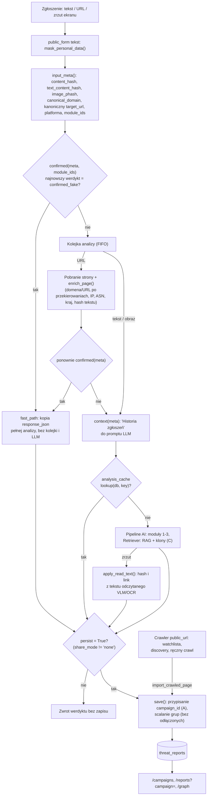

# Kampanie fejków — jak działa wykrywanie i grupowanie

Dokument opisuje, jak Ryziqo łączy pojedyncze zgłoszenia i incydenty w **kampanie** (jedna akcja oszustów rozprowadzana wieloma kanałami), jak z tego korzysta analityk oraz jakie błędy logiki wykrył przegląd i jak zostały naprawione. Stan kodu: `main` @ `06e9712` + poprawki K1–N3 (2026-11-22).

W systemie działają **trzy niezależne mechanizmy**, które razem nazywamy „kampaniami”:

| # | Mechanizm | Na czym działa | Kod | Efekt |
|---|-----------|----------------|-----|-------|
| A | Grupowanie zgłoszeń (`campaign_id`) | tabela `threat_reports` — identyczne odciski (hash treści/tekstu, pHash obrazu, domena/URL) | `backend/app/threat_intel.py` (`Intelligence.relation`, `Intelligence.save`) | Zgłoszenia trafiają do jednej grupy; analityk może ocenić całą grupę jednym kliknięciem lub odłączyć błędnie przypisane zgłoszenie |
| B | Szybka ścieżka (`fast_path`) | zgłoszenia ze statusem `confirmed_fake` | `threat_intel.py` (`Intelligence.confirmed`), `routers/analyze.py` (`dispatch.known`) | Ponowne zgłoszenie znanego fejka dostaje gotowy werdykt bez uruchamiania LLM |
| C | Klony kampanii (`CAMPAIGN_CLONE_MATCH`) | tabela `incidents` + wektory z `content_snapshots` — podobieństwo semantyczne | `backend/app/ai/retrieval.py`, `ai/aggregator.py` (`apply_clone_matches`) | Treść podobna do potwierdzonego incydentu z innego źródła dostaje regułę wysokiej wagi i podbity wynik |

Werdykty A/B (`threat_reports.verdict_status`) i C (`incidents.status` / `ground_truth_label`) są synchronizowane w obie strony przez jeden moduł mapowania: `backend/app/verdicts.py`.

Do tego dochodzi warstwa prezentacji: **lista kampanii** (`/campaigns`) i **mapa powiązań** (`/graph`, `backend/app/graph.py`).

---

## A. Grupowanie zgłoszeń w kampanie (`campaign_id`)

### 1. Odciski zgłoszenia — `input_meta()` / `enrich_page()` / `apply_read_text()`

Każde zgłoszenie (formularz obywatela, panel analityka, API, crawler, import historii) dostaje zestaw identyfikatorów:

| Pole | Skąd | Uwagi |
|------|------|-------|
| `content_hash` | SHA-256 z `normalized(text)`: NFKC → `deobfuscate_text()` (znaki zero-width, homoglify cyrylickie/greckie, rozstrzelone litery) → `casefold` → zwinięte białe znaki. Dla `public_form` tekst jest wcześniej maskowany (`mask_personal_data()`). Dla URL — po `enrich_page()` z tekstu HTML po usunięciu `<script>`/`<style>` (fallback: `raw_html`). Dla zrzutu — SHA-256 surowych bajtów obrazu. | W tabeli `incidents` pole `content_hash` liczone jest inaczej (24-znakowy prefiks SHA-256 z `source_url::clean_text.lower()`). |
| `text_content_hash` | hash znormalizowanego **tekstu**: dla tekstu i URL równy `content_hash`; dla zrzutu ekranu — z tekstu odczytanego przez VLM/OCR (`apply_read_text()`) | Łączy zrzut ekranu reklamy z wklejonym tekstem tej samej reklamy. |
| `image_phash` | 64-bitowy perceptual hash (DCT 32×32 → 8×8, próg mediany po `exif_transpose`) | Odporny na rekompresję JPEG i lekkie przycięcie; dla jednolitych grafik zwraca `None`. Import historii wylicza go z zapisanego zrzutu w `object_store`. |
| `canonical_domain` | domena rejestrowalna (`tldextract` z prywatnymi sufiksami PSL) z `body.url`, albo z **pierwszego linku w tekście, który nie należy do `NON_MERGING_DOMAINS`** (fallback: pierwszy link), albo `body.source_url`; dla URL — z `page.final_url` po przekierowaniach; dla zrzutu bez domeny — z linku w odczytanym tekście | `domain_of()` akceptuje niestandardowe porty i `user@host` (`https://knf.gov.pl@evil.xyz` → `evil.xyz`). |
| `target_url` | URL po `canonicalize_url()` (bez `utm_*`, `fbclid`, `gclid`, `si`…, bez fragmentu, ujednolicony host i końcowy `/`); dla URL — kanoniczny `page.final_url` | Pierwotny URL zostaje jako `redirect_chain[0]`. |
| `target_server_ip`, `hosting_asn`, `hosting_country` | tylko dla URL po pobraniu strony (ASN/kraj z lokalnej bazy MaxMind/DB-IP, jeśli skonfigurowana) | |
| `platform` | jawne `body.platform`, inaczej mapa `platforms` (`facebook.com`/`fb.com`/`instagram.com` → `Meta / Facebook`, `youtube.com`/`youtu.be` → `YouTube`, `tiktok.com` → `TikTok`, `x.com`/`twitter.com` → `X`, `googleadservices.com` → `Google Ads`, `t.me` → `Komunikator / SMS`), fallback: `Strona WWW` / `Inne`; przeliczana po zmianie domeny, chyba że podano ją jawnie | |
| `module_ids` | posortowana lista modułów, których dotyczy werdykt (JSON) | `NULL` dla importu historii (brak wiedzy o zakresie analizy). |

`NON_MERGING_DOMAINS` (domeny współdzielone przez niepowiązane materiały): `platforms`, skracacze (`SHORTENER_HOSTS`), link-in-bio (`LINK_IN_BIO_HOSTS`), instytucje i serwisy referencyjne (`knf.gov.pl`, `*.gov.pl`, `nbp.pl`, `gpw.pl`, `europa.eu`, `wikipedia.org`, `google.com`, `bing.com`), komunikatory (`wa.me`, `whatsapp.com`, `telegram.me`, `telegram.org`, `discord.gg`, `discord.com`) oraz hostingi formularzy (`forms.gle`, `office.com`, `typeform.com`). Dopasowanie obejmuje subdomeny.

### 2. Predykat powiązania — `Intelligence.relation(meta, mode)`

| Warunek | `fast` (przejęcie werdyktu) | `merge` (grupowanie w kampanię) | `context` (podpowiedź dla LLM) |
|---------|:---:|:---:|:---:|
| ten sam `content_hash` lub `text_content_hash` (krzyżowo) | ✔ | ✔ | ✔ |
| `image_phash` w odległości Hamminga ≤ 6 bitów | ✔ | ✔ | ✔ |
| ta sama domena **i** ten sam kanoniczny `target_url` | ✔ | ✔ (gdy domena w `NON_MERGING_DOMAINS`) | ✔ (gdy w `NON_MERGING_DOMAINS`) |
| sama ta sama domena | ✘ | ✔ (gdy **nie** w `NON_MERGING_DOMAINS`) | ✔ (gdy nie w `NON_MERGING_DOMAINS`) |
| ten sam `target_server_ip` | ✘ | ✘ | ✔ |

Uzasadnienie:
- sama domena nie wystarcza do przejęcia werdyktu — inaczej potwierdzenie jednego fejka z linkiem do `knf.gov.pl` oznaczałoby jako fejk każdy tekst z takim linkiem (`test_shared_domain_alone_does_not_reuse_confirmed_verdict`);
- domeny współdzielone (`NON_MERGING_DOMAINS`) nie sklejają kampanii samą domeną — dwa niepowiązane teksty z linkiem do `knf.gov.pl` lub `bit.ly` trafiają do różnych grup;
- IP serwera nigdy nie łączy kampanii, bo CDN / hosting współdzielony obsługuje niepowiązane strony (`test_shared_server_ip_does_not_merge_campaigns`);
- warunek pHash jest wyliczany podzapytaniem po częściowym indeksie `threat_phash` (`WHERE image_phash IS NOT NULL`), więc funkcja Pythona `hamming()` nie skanuje wierszy bez zrzutów.

Warunki łączone są przez `OR` — wystarczy jedno trafienie. Brak dopasowanych kluczy zwraca `(0)`.

### 3. Przypisanie i scalanie — `Intelligence.save()`

W jednej transakcji `BEGIN IMMEDIATE` (wywoływanej wyłącznie gdy `persist=True`):
1. wyszukuje wszystkie istniejące `campaign_id` zgłoszeń spełniających `relation(meta, "merge")`, rozróżniając zgłoszenia odłączone ręcznie (`campaign_locked=1`);
2. brak trafień → nowy `campaign_id` (`uuid4().hex`); są trafienia w grupach nieodłączonych → **najmniejszy** z nich; trafione tylko zgłoszenia odłączone → ich grupa;
3. pozostałe trafione grupy są przepisywane na wybrany identyfikator (scalanie przechodnie), **z pominięciem zgłoszeń odłączonych** — automatyczne scalanie nie cofa ręcznego rozdzielenia;
4. zapisuje nowe zgłoszenie z tym `campaign_id`.

Każde zapisane zgłoszenie ma `campaign_id`, ale **kampanią** w UI/API jest dopiero grupa z ≥ 2 zgłoszeniami.

Źródła wierszy `threat_reports` poza analizą na żądanie:
- `import_crawled_page()` (`origin='crawler'`) — od razu po każdej stronie przeanalizowanej w `_process_public_url()` (ręczny crawl URL, watchlista, SearXNG discovery, podstrony `follow_depth > 0`); używa samego `FetchedPage`, więc hash, `redirect_chain`, `final_url` i IP są takie jak przy analizie URL na żądanie;
- `import_history()` (`origin='history'`) — przy starcie aplikacji dla incydentów nieobecnych w `threat_reports` oraz po zadaniach `mock_all` / `mock_single`; hash liczony z pełnego `normalized_text` artefaktu, a dla zrzutów pHash z pliku w `object_store`.

### 4. API i UI kampanii

| Endpoint | Działanie |
|----------|-----------|
| `GET /api/v1/intelligence/campaigns` | grupy z `count(*) > 1`; parametry `active_only` (jak pulpit: bez grup w całości `false_positive`), `limit` (domyślnie 100), `offset`. Pola: `members`, `max(risk_score)`, `domain` (najczęstsza niepusta `canonical_domain`), `server_ip`, `last_seen`, `new_count` / `confirmed_count` / `review_count` / `fp_count`, ostatnia `analyst_notes` |
| `PATCH /api/v1/intelligence/campaigns/{id}` | `verdict_status` i/lub `analyst_notes` dla **wszystkich** zgłoszeń grupy; werdykt jest przenoszony na powiązane incydenty i na pozostałe zgłoszenia tych incydentów; zwraca `{"updated": N}` |
| `PATCH /api/v1/intelligence/reports/{id}` | jak wyżej dla jednego zgłoszenia |
| `POST /api/v1/intelligence/reports/{id}/detach` | przenosi zgłoszenie do nowej grupy (`campaign_locked=1`), zwraca `{"campaign_id": …}` |
| `GET /api/v1/intelligence/reports?campaign={id}` | lista zgłoszeń z kampanii (paginacja `limit`/`offset`, filtr `verdict`, wyszukiwanie `q`) |
| `GET /api/v1/intelligence/leaderboard` | ranking podpisanych zgłaszających (pseudonim + klucz; anonimowi pomijani): **1 punkt za każdą potwierdzoną kampanię (fejk), którą dana osoba zgłosiła**, niezależnie od tego, czy wcześniej zgłosił ją ktoś inny; ponowne zgłaszanie tego samego fejka przez tę samą osobę nie daje kolejnych punktów |
| `GET /api/v1/intelligence/diagnostics` | pole `campaigns` = liczba grup ≥ 2, w których co najmniej jedno zgłoszenie nie jest `false_positive` („Aktywne kampanie”) |

Frontend: `frontend/src/pages/Intelligence.jsx` — `Campaigns` (przełącznik „Tylko aktywne”, domyślnie włączony) i `Campaign` (ryzyko, `last_seen`, rozkład statusów, status domyślnie ustawiony na dominujący w grupie, notatka kampanii, „Zastosuj do całej kampanii”); w szczegółach zgłoszenia przycisk „Odłącz od kampanii”.

---

## B. Szybka ścieżka dla znanych fejków (`fast_path`)

`dispatch()` w `backend/app/routers/analyze.py`, funkcja `known()`:

1. Wywoływana **przed** wstawieniem do kolejki, a dla URL ponownie **po pobraniu strony** i `enrich_page()`.
2. `confirmed(meta, module_ids)`:
   - bierze **najnowszą decyzję analityka** (`confirmed_fake` lub `false_positive`) wśród zgłoszeń spełniających `relation(meta, "fast")` — jeśli to `false_positive`, szybkiej ścieżki nie ma (nowsza korekta odwołuje starsze potwierdzenie);
   - jako źródło wybiera zgłoszenie `confirmed_fake` z pełnej analizy (`origin` `ollama`/`rules` przed `history`/`crawler`/`cache`, a `fast_path` na końcu), które obejmuje żądane `module_ids` (wiersze bez listy modułów są akceptowane);
   - `count` liczy dopasowane zgłoszenia z pominięciem `false_positive`;
   - `duration` źródła to maksimum z jego czasu i czasu pełnych analiz (`ollama`/`rules`) w jego kampanii.
3. Trafienie → odpowiedź z `response_json` źródła, `source_type` nadpisany bieżącym typem wejścia, `result_origin='fast_path'`. Prefiks `"Dopasowano do potwierdzonego zagrożenia w bazie zgłoszeń (liczba wcześniejszych zgłoszeń: N). "` jest doklejany **tylko do odpowiedzi** — zapisana kopia ma bazowe podsumowanie, więc prefiks się nie piętrzy.
4. Gdy `persist=True` — zapis przez `save()` z `verdict_status='new'`, `matched_id` i `saved_seconds = max(0, duration_źródła - duration)`.
5. `force_full=true` pomija zarówno `fast_path`, jak i `analysis_cache`.

Werdykt `confirmed_fake` ustawia się na cztery sposoby (wszystkie spójne dzięki `app/verdicts.py`):
- `PATCH /api/v1/intelligence/reports/{id}` lub `/campaigns/{id}` — propagacja na incydenty (`confirmed_fake` → `status='confirmed', ground_truth_label=1`; `false_positive` → `status='false_positive', ground_truth_label=0`; `requires_review` → `status='in_review'`; `new` → `status='new', ground_truth_label=NULL`);
- `PATCH /api/v1/incidents/{id}/status` — aktualizuje **wszystkie** zgłoszenia zawierające incydent (`dismissed` → `false_positive`) i uzgadnia `ground_truth_label` dla `confirmed` / `false_positive` / `dismissed`;
- `PATCH /api/v1/incidents/{id}/label` — `true` → `confirmed_fake`, `false` → `false_positive` w zgłoszeniach o statusie `new` / `requires_review` (decyzja analityka na zgłoszeniu nie jest nadpisywana).

### Kontekst dla LLM — `context(meta)`

Gdy nie ma trafienia `fast_path`, `context(meta)` (tryb `context`, obejmujący również `target_server_ip`) pobiera do 5 ostatnich powiązanych zgłoszeń. Jeśli brak trafień — porównuje zbiory słów (Jaccard ≥ 0,7) z ostatnimi 150 zgłoszeniami, ale tylko po odfiltrowaniu stop-słów i tokenów < 3 znaków i tylko gdy obie strony mają ≥ 6 takich tokenów. Wynik (maks. 145 znaków) trafia do metadanych promptu jako `"Historia zgłoszeń"` (`ai/context.py`). To wyłącznie wskazówka dla modelu.

---

## C. Klony potwierdzonych kampanii (`CAMPAIGN_CLONE_MATCH`)

Wykrywa ten sam scam **przeredagowany lub przeniesiony na inną domenę** — tam, gdzie `content_hash` już nie pasuje.

### Źródło wiedzy

`Database.list_verified_incident_vectors()` — incydenty zweryfikowane przez analityka, złączone z `content_snapshots` po `content_hash`, w **dwóch osobnych oknach** po `limit` (domyślnie 500) najnowszych: potwierdzonych i odrzuconych (seria fałszywych alarmów nie wypycha potwierdzonych kampanii):
- etykieta wynika najpierw ze `status` (`confirmed` → `True`, `false_positive`/`dismissed` → `False`), a dopiero przy innym statusie z `ground_truth_label` — nieaktualna etykieta `1` nie utrzymuje odrzuconego incydentu w pamięci klonów;
- incydenty bez rekordu w `content_snapshots` (np. startowe dane demo z `storage_key: null`) są niewidoczne dla mechanizmu C;
- wektory: embedding Ollama (gdy był dostępny) oraz deterministyczny 128-wymiarowy wektor feature-hashing (`build_local_embedding`: bez stop-słów PL/EN, waga `1 + log(tf)`);
- `best_similarity()` porównuje wektory o **największej wspólnej wymiarowości** (np. 768-dim Ollama); wektor 128-dim to wyłącznie fallback, gdy jedna ze stron nie ma embeddingu semantycznego;
- incydenty z identycznym `content_hash` są pomijane w SQL.

### Reguła klonu — `Retriever.analyze()`

Kandydat jest klonem, gdy jednocześnie:
- `best_similarity` ≥ `AI_CLONE_SIMILARITY_THRESHOLD` (domyślnie **0,85**),
- oryginał ma etykietę `True`,
- `is_other_source()`: źródła są różne według `source_domain()` — dla HTTP/HTTPS domena rejestrowalna (`domain_of`, ta sama definicja co w A), dla wklejonego tekstu (`manual://text`, puste) brak źródła (`""`, zawsze „inne”), dla `mock://` i `manual://screenshot/<sha>` cały URL.

Zwracane są maks. 3 klony; `apply_clone_matches()`:
- cel: moduł oryginału pierwszego klonu, a gdy go nie ma — moduł z najwyższym `risk_score`;
- dodaje regułę `CAMPAIGN_CLONE_MATCH` (`severity="high"`) z polem `related_incident_ids` (wszystkie wykryte oryginały) i cytat `[Klon] …` dla każdego klonu;
- wynik: `max(obecny, min(0,95, ryzyko_oryginału × podobieństwo))` — limit 0,95 ogranicza wyłącznie podbicie, nigdy nie obniża wcześniejszego wyniku.

Kolejność w pipeline: `Retriever.analyze()` → moduły AI (1–3 równolegle) → `apply_registry_guard` → `apply_clone_matches` → `apply_vision` → `select_results`. W trybie `AGGREGATOR_MULTI_MODULE_MODE="primary"` reguła `CAMPAIGN_CLONE_MATCH` i cytaty `[Klon]` z modułów wtórnych są przenoszone do modułu wybranego.

Ten sam `Retriever` dostarcza **RAG few-shot**: dla każdego modułu najbliższy przykład pozytywny i negatywny o podobieństwie ≥ 0,45; pomijana jest tylko inna wersja tej samej strony (ten sam `source_url` z rozpoznanym źródłem) — wklejone teksty są rozróżniane po `content_hash`/`id`.

`GET /api/v1/incidents/{id}/similar` pokazuje zweryfikowane incydenty podobne do danego (próg 0,45) z flagą `is_clone` liczoną tą samą regułą.

---

## Mapa powiązań — `graph.py`

`GET /api/v1/intelligence/graph` (`min_score` domyślnie 0,5, `limit` domyślnie 200, `max_nodes` = 400) pobiera `limit` najnowszych incydentów o ryzyku ≥ `min_score` z pominięciem `false_positive` i `dismissed` **już w SQL** (`list_incidents(exclude_statuses=…)`), a potwierdzone oryginały klonów spoza tego okna dociąga przez `get_incident()`:

| Węzeł | Krawędź | Źródło |
|-------|---------|--------|
| `domain` | `published_on` | `domain_of(inc.source_url)` |
| `promoter` | `promotes` | `promoter_name` (poza `UNKNOWN_ENTITIES`) |
| `entity` | `advertises` | `entity_name` (poza `UNKNOWN_ENTITIES`, bez fallbacku na tytuł/URL) |
| `link_domain` | `links_to` | domeny z pierwszych 40 linków (`resolved_links` + `outbound_links`) artefaktu, bez własnej domeny i `platforms` (`resolved_links` puste przy `CRAWLER_EXPAND_SHORT_LINKS=false`) |
| `referral_code` | `uses_code` | parametry `ref`, `refid`, `referral`, `aff`, `affid`, `affiliate`, `code`, `promo`, `promocode`, `invite`, `partner`, `utm_campaign` z linków |
| `warning_list` | `on_warning_list` | reguła `KNF_WARNING_LIST_MATCH` |
| incydent → incydent | `clone_of` | `related_incident_ids` reguły `CAMPAIGN_CLONE_MATCH` (regex po `reason` tylko dla starych danych) |
| `campaign` | `in_campaign` | `campaign_id` grup ≥ 2 z co najmniej jednym zgłoszeniem innym niż `false_positive`, pokazywane tylko gdy na mapie są ≥ 2 incydenty kampanii |

Węzły satelitarne (`domain`, `link_domain`, `referral_code`) o stopniu ≤ 1 są ukrywane. Frontend: `frontend/src/pages/Graph.jsx`.

Graf pokazuje dwa rodzaje „kampanii”: twarde grupy z A (węzeł `campaign`) i semantyczne klony z C (krawędź `clone_of`), a dodatkowo miękkie powiązania (wspólny promotor, kod polecający, domena docelowa), których system **nie** zapisuje jako kampanii.

---

## Przegląd logiki — wykryte błędy i wprowadzone poprawki

Wszystkie pozycje z przeglądu zostały naprawione; każda ma test regresyjny w `backend/tests/test_campaign_fixes.py`.

| ID | Priorytet | Błąd | Poprawka | Test |
|----|-----------|------|----------|------|
| K1 | Krytyczny | Crawler `public_url` (watchlista, discovery, ręczny crawl, podstrony) nie zasilał `threat_reports` do restartu — brak kampanii i `fast_path` dla realnie skanowanych stron | `CrawlQueueWorker._analyze_and_register()` → `Intelligence.import_crawled_page()` dla `root` i każdej podstrony, z metadanymi `FetchedPage`; błąd rejestru nie przerywa zadania crawla | `test_k1_public_url_crawl_feeds_registry_and_fast_path` |
| K2 | Krytyczny | Popularne domeny (`knf.gov.pl`, `bit.ly`…) sklejały niepowiązane kampanie; brany był pierwszy link w tekście; `domain_of()` odrzucał porty i `user@host` | `NON_MERGING_DOMAINS` wymagają kanonicznego URL; `pick_link()` pomija domeny neutralne; `domain_of()` czyta host z `hostname` | `test_k2_*` |
| K3 | Krytyczny | Brak synchronizacji werdyktów `threat_reports` ↔ `incidents`; `LIMIT 1`; etykieta wygrywała ze statusem; rozbieżne mapowanie `dismissed` | `app/verdicts.py` (jedno mapowanie); propagacja w PATCH raportu/kampanii, aktualizacja wszystkich zgłoszeń incydentu, uzgadnianie etykiety, synchronizacja w PATCH etykiety; status ma pierwszeństwo w `list_verified_incident_vectors()` | `test_k3_*` |
| W1 | Wysoki | Brak kanonizacji URL; domena/URL nieaktualizowane po przekierowaniach | `canonicalize_url()` w `input_meta()`; `enrich_page()` ustawia domenę i URL z `final_url` | `test_w1_tracking_params_and_redirects_are_canonicalized` |
| W2 | Wysoki | `fast_path` dopasowywał się do wcześniejszej kopii `fast_path` — piętrzący się prefiks i `saved_seconds ≈ 0` | preferencja pełnej analizy w `confirmed()`; prefiks tylko w odpowiedzi; czas z pełnej analizy kampanii | `test_w2_fast_path_points_at_full_analysis` |
| W3 | Wysoki | Wklejone teksty (`manual://text`) miały wspólną „domenę” — brak klonów i przykładów RAG między nimi | `source_domain()` zwraca `""` dla tekstu bez źródła; `is_other_source()`; RAG wyklucza tylko inną wersję tej samej strony | `test_w3_pasted_texts_can_be_clones_and_rag_examples` |
| W4 | Wysoki | Obfuskacja omijała hash; niespójny hash importu historii; zrzut ekranu nie łączył się z tekstem | `deobfuscate_text()` w `normalized()`; hash z pełnego tekstu artefaktu i pHash z pliku; kolumna `text_content_hash` + `apply_read_text()` po VLM/OCR | `test_w4_*` |
| W5 | Wysoki | `cap` obniżał wynik > 0,95; w trybie `primary` reguła klonu znikała z modułu wtórnego | `_apply_finding()` ogranicza tylko podbicie; `select_results()` przenosi regułę i cytaty `[Klon]` | `test_w5_clone_never_lowers_score_and_survives_primary_selection` |
| S1 | Średni | `max(ollama, local_128)` dawał fałszywe klony; brak stop-słów | priorytet największej wspólnej wymiarowości; stop-słowa i `1 + log(tf)` w wektorze lokalnym | `test_s1_semantic_vector_decides_over_local_hash` |
| S2 | Średni | Różne definicje domeny w A i C | `source_domain()` używa `domain_of()` | `test_s2_subdomains_are_one_site` |
| S3 | Średni | `fast_path` ignorował `module_ids`, nowszą korektę `false_positive` i liczył FP w `count` | kolumna `module_ids` i sprawdzenie pokrycia; najnowsza decyzja wygrywa; `count` bez FP | `test_s3_*` |
| S4 | Średni | Kruche krawędzie `clone_of` (regex); FP/`dismissed` zjadały limit; znikający starsi oryginałowie; osierocone kampanie | `ViolatedRule.related_incident_ids`; `exclude_statuses` w SQL; dociąganie oryginałów; filtr aktywnych kampanii z ≥ 2 incydentami | `test_s4_graph_uses_structured_clone_link_and_sql_filter` |
| S5 | Średni | Niespójne liczenie kampanii, ignorowane `analyst_notes`, etykieta `min()`, brak rozdzielania, uboga karta UI | `active_only`, paginacja, rozkład statusów, dominująca domena, zapis notatek, `POST …/detach` z blokadą scalania, nowa karta kampanii | `test_s5_campaign_listing_notes_and_detach` |
| N1 | Niski | `hamming()` skanował całą tabelę pod blokadą | częściowy indeks `threat_phash` + podzapytanie | `test_n1_phash_index_and_n3_short_text_hint` |
| N2 | Niski | Okno 500 mieszało potwierdzone z FP; używany był 1 z 3 klonów | osobne okna etykiet; wszystkie klony w `related_incident_ids` i cytatach | `test_n2_*`, `test_w5_*` |
| N3 | Niski | Jaccard bez stop-słów dla krótkich tekstów | stop-słowa, tokeny ≥ 3 znaki, minimum 6 tokenów | `test_n1_phash_index_and_n3_short_text_hint` |

### Skutki uboczne i ograniczenia

- **Zmiana hashy:** `normalized()` stosuje teraz anty-obfuskację, a `target_url` jest kanonizowany. Zgłoszenia zapisane wcześniej z obfuskowanym tekstem lub surowym URL nie dopasują się już po hashu/URL do nowych zgłoszeń (dopasowanie po domenie i pHash działa jak wcześniej). Zwykły tekst bez obfuskacji w praktyce zachowuje dawny hash.
- **Wektor lokalny:** po zmianie `build_local_embedding()` (stop-słowa, waga log) podobieństwo nowych dokumentów do wektorów zapisanych wcześniej jest nieco niższe niż między dokumentami liczonymi tą samą wersją; wymiar (128) się nie zmienił.
- **`fast_path` a moduły:** werdykt potwierdzony dla analizy tylko modułu 2 nie zostanie użyty dla żądania modułów `[1, 2, 3]` (formularz obywatela) — wymagana jest pełna analiza.
- **pHash przy dużej skali:** indeks częściowy ogranicza skan do wierszy ze zrzutem; przy > 10 tys. zrzutów warto dodać multi-index hashing (np. 7 bloków dla progu Hamminga ≤ 6).
- **Odłączanie:** zgłoszenie odłączone pozostaje w swojej grupie; nowe zgłoszenie pasujące jednocześnie do grupy wolnej i odłączonego zgłoszenia dołącza do grupy wolnej.

---

## Konfiguracja

| Zmienna | Domyślnie | Znaczenie |
|---------|-----------|-----------|
| `AI_CLONE_SIMILARITY_THRESHOLD` | `0.85` | próg podobieństwa kosinusowego dla `CAMPAIGN_CLONE_MATCH` |
| `AI_RAG_FEW_SHOT_ENABLED` | `true` | włącza dynamiczny RAG few-shot z `Retriever` |
| `RAG_MIN_SIMILARITY` (stała w `retrieval.py`) | `0.45` | minimalne podobieństwo przykładów few-shot i listy `/incidents/{id}/similar` |
| `DEDUP_SIMILARITY_THRESHOLD` | `0.92` | próg podobieństwa do deduplikacji ponownych skanów tego samego URL i modułu (`queue_worker.py`) |
| `AGGREGATOR_MULTI_MODULE_MODE` | `primary` | `primary` (1 incydent na stronę; reguła klonu przenoszona do modułu wybranego) vs `all_significant` |
| `CRAWLER_EXPAND_SHORT_LINKS` | `false` | rozwijanie skracaczy/link-in-bio do `resolved_links` (zasila węzły `link_domain` i `referral_code` na grafie) |
| `HOSTING_ASN_DB`, `HOSTING_COUNTRY_DB` | `""` | ścieżki do lokalnych baz MaxMind/DB-IP dla `enrich_page()` |
| `NON_MERGING_DOMAINS` (stała w `threat_intel.py`) | zob. sekcja A.1 | domeny, które łączą zgłoszenia tylko przy identycznym kanonicznym URL |
| próg pHash (stała w `relation`) | `≤ 6` bitów z 64 | dopasowanie zrzutów ekranu |
| Jaccard w `context()` (stała) | `≥ 0.7`, min. 6 tokenów, ostatnie 150 zgłoszeń | luźna historia dla promptu |
| `REPORT_LIMIT_PER_MINUTE` | `30` | limit zgłoszeń na IP (ogranicza zalewanie kampanii zgłoszeniami) |

## Testy

- `backend/tests/test_intelligence.py` — szybka ścieżka, `force_full`, grupowanie w jedną kampanię, zbiorczy `PATCH /campaigns/{id}`, odporność pHash na rekompresję, brak przejęcia werdyktu po samej domenie, brak scalania po IP, limit zgłoszeń, czyszczenie usuniętych tabel.
- `backend/tests/test_ai_detection.py` — reguła klonu i podbicie wyniku, brak klonu na tej samej domenie, RAG few-shot w prompcie, lista zweryfikowanych wektorów.
- `backend/tests/test_differentiators.py` — `/incidents/{id}/similar` z `is_clone`, graf z krawędzią `clone_of`, kodami polecającymi i `link_domain`, tryby zgody obywatela.
- `backend/tests/test_campaign_fixes.py` — testy regresyjne K1–N3 (tabela powyżej).
